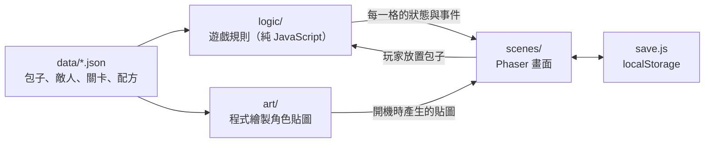
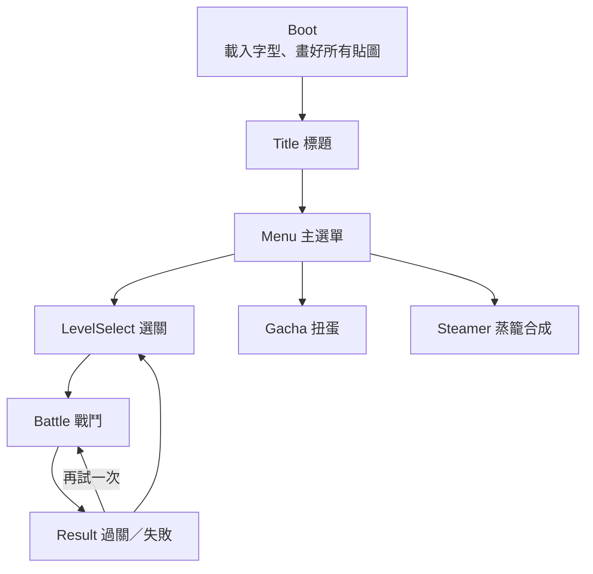

# 包包早餐店保衛戰（baobao）

*   **Author:** MengChiehLiu
*   **Status:** Draft
*   **Date:** 2026-11-14

--------------------------------------------------------------------------------

## Overview

一款給女朋友玩的單機塔防遊戲，共 10 關，用手機或電腦開網頁就能玩。

玩家在早餐店的直線車道上放置可愛的包子和饅頭，擋住來偷吃的老鼠、螞蟻、蟑螂和鴿子。每種包子的攻擊方式都不同，例如小籠包會噴熱湯、流沙包會留下減速水灘、刈包會夾住敵人。少數奇葩包子要另外取得。

畫面採日系可愛風格，角色、背景和介面全部用程式繪製，靠動作（壓扁彈起、輕晃、冒蒸氣）帶出可愛感。遊戲用 JavaScript 和 Phaser 引擎製作，放在免費靜態網站上。

## The Problem

她想玩一款塔防遊戲，而且要可愛、好看、不會太難。現有的塔防遊戲不是為她做的：主題跟她無關，也常常有付費抽卡或體力限制。

開發者會寫程式（主要是 Python），但沒有做過遊戲，也不會畫畫。所以這個設計要解決三件事：

1. **美術：** 沒有畫畫能力，也要做出好看的日系可愛畫面。解法是用程式繪製圓潤的角色，加上柔和的色票和 Q 彈的動作。
2. **工作量：** 這是興趣專案，不能做太久。解法是包子、敵人和關卡都做成資料，每種包子的特殊效果由少數幾個共用的「效果零件」組合，不用每種都從頭寫。
3. **裝置：** 她要能在手機和電腦上玩，而且不用安裝。解法是做成網頁遊戲，以橫向手機畫面和點擊操作為主。

## Goals

*   **可以玩完 10 關：** 每關加入一種新包子或新敵人，關卡本身就是教學。
*   **難度輕鬆：** 她不需要開發者解釋，就能自己玩到第 10 關。可以輸，但輸了一點就能重來，載入不超過 2 秒。
*   **包子各有不同行為：** 5 種基本包子的攻擊方式都不同，不只是數值不同：白饅頭擋路、叉燒包射擊、小籠包噴湯、流沙包減速、刈包夾住。
*   **有奇葩包子可以取得：** 共 5 種稀有包子，取得方式有兩種（作者決定兩種都做）：
    *   **抽獎：** 3 種一般稀有包子。
    *   **蒸籠合成：** 2 種最奇葩的包子。
*   **4 種敵人：** 螞蟻（弱，成群出現）、老鼠（標準）、蟑螂（快）、鴿子（會飛過饅頭，後期才出現）。
*   **畫面好看：** 日系可愛風格；每種包子都有放置、待機、攻擊、被打到的動畫；每種包子的輪廓都不同，一眼就能認出來。
*   **手機和電腦都能玩：** 在她的手機瀏覽器上，橫向畫面能流暢執行（目標每秒 60 格，最低 30 格），所有操作都能用點擊完成。
*   **數值好調整：** 包子、敵人和關卡的數值都放在 JSON 檔裡，調整難度不需要改程式碼。

## Non-Goals

*   **收集或圖鑑系統：** 塔防才是重點，取得包子只是附帶的功能。
*   **真錢付費、體力限制、帳號、伺服器、多人連線。**
*   **存檔保護：** 存檔只放在瀏覽器裡，遺失可以接受。不做匯出碼，也不做跨裝置同步。
*   **需要尋路的迷宮式塔防：** 敵人只沿著直線車道前進。
*   **外部插圖或 AI 生成的圖片：** 所有美術都用程式繪製。
*   **獨立的美術預覽頁：** 美術直接在遊戲裡調整。
*   **原生 App 或上架商店。**
*   **直向畫面：** 直拿手機時只顯示「請轉橫」提示。
*   **第一版不做的包子：** 榴槤包、麻糬包、花捲。

## Open Questions

*   **她的手機：** iPhone 還是 Android？設計先假設兩種都要支援。
*   **聲音：** 要不要音效或背景音樂？技術計畫先預留音效的位置，但不做音樂。
*   **互動規則的預設值：** 技術計畫第 4 節先定了一組規則，例如敵人會咬包子、減速取最強的不疊加。想改的話直接說。

## Critical User Journeys (CUJs)

### CUJ 1：第一次打開遊戲並過第一關

*   **Given**：她在手機瀏覽器打開遊戲網址，手機拿橫的。
*   **When**：點「開始」，進入第 1 關，先點包子卡片再點格子，把包子放到車道上。
*   **Then**：包子放下時有壓扁彈起的動畫，自動攻擊來的螞蟻；所有敵人被打倒後，顯示過關畫面和獲得的包子券。

### CUJ 2：輸了重來

*   **Given**：她在第 5 關，有 3 隻敵人走到櫃台。
*   **When**：出現「被偷吃了」的畫面，她點「再試一次」。
*   **Then**：2 秒內重新開始同一關；這局撿到的食材都保留。

### CUJ 3：抽獎拿到新包子

*   **Given**：她有至少 1 張包子券。
*   **When**：在主選單點「扭蛋」，再點「抽一次」。
*   **Then**：播放扭蛋動畫，抽到一種她還沒有的稀有包子；之後選關時就能帶這種包子上場。

### CUJ 4：蒸籠合成發現奇葩包子

*   **Given**：她有足夠的食材。
*   **When**：在主選單點「蒸籠」，選兩種食材放進蒸籠，點「蒸！」。
*   **Then**：配方對的話，跑出新包子並永久解鎖；配方錯的話，跑出一顆「失敗的醜包子」，食材全部退回。

## Technical Plan (Architecture)

### 1. 技術選擇

| 項目 | 選擇 | 原因 |
|---|---|---|
| 遊戲引擎 | Phaser 3（固定在 3.90.0） | 手機瀏覽器上穩定，內建補間動畫、粒子系統、畫面縮放和觸控 |
| 語言 | JavaScript，不用 TypeScript | 少一個編譯步驟；資料結構用 JSDoc 註解說明 |
| 打包工具 | Vite | 開發時改了程式會自動重新整理，也能打包成靜態網站 |
| 網站 | GitHub Pages，由 GitHub Actions 自動部署 | 免費，網址固定 |
| 周邊工具 | Python | 檢查 JSON 資料是否合法、裁切字型 |

### 2. 程式分三層

遊戲規則不碰 Phaser，Phaser 只負責畫圖和接收點擊。這樣規則可以單獨測試，畫面也可以隨意調整，不會改壞規則。

*   **data：** 所有數值和內容。調整難度、新增包子只改這裡。
*   **logic：** 遊戲規則。用固定時間步長（每步 1/60 秒）更新，同樣的輸入永遠得到同樣的結果。規則層丟出事件（例如「小籠包噴湯」「敵人被打倒」），由畫面層播動畫。
*   **art：** 根據每種包子的外觀參數畫出貼圖，開機時畫一次後重複使用。
*   **scenes：** Phaser 的各個畫面。
*   **save.js：** 讀寫存檔。

### 3. 畫面流程

另外有一層「請轉橫」提示，只要手機拿直的就蓋在所有畫面上面。

### 4. 戰鬥規則

**場地：** 5 條車道 × 9 格，橫向畫面。基準解析度 960×540，用 Phaser 的 `Scale.FIT` 等比例縮放到螢幕大小。左邊是櫃台，敵人從右邊出現往左走。

**放包子：**
*   戰鬥中會自動累積「蒸氣」（每 4 秒 +25），打倒敵人也會掉蒸氣。放包子要花蒸氣。
*   先點下方的包子卡片，再點空格子。放下後該卡片要冷卻幾秒才能再用。
*   每關最多帶 6 種包子上場。

**敵人：** 每隻敵人只記錄車道、橫向位置、血量、基本速度和目前的效果。

**效果零件：** 每種包子是一筆資料，列出它用哪些效果零件。

| 零件 | 做什麼 |
|---|---|
| `shoot` | 往同一條車道前方發射子彈 |
| `splash` | 打到目標時，對附近半徑內的敵人造成傷害 |
| `puddle` | 在地上留下一塊區域，敵人走過速度乘上一個倍率 |
| `clamp` | 夾住一隻敵人，讓牠停止並持續受傷 |
| `block` | 不攻擊，血量很高，擋住敵人 |

**互動規則（預設值，可以改）：**
*   敵人碰到包子會停下來咬，包子血量歸零就消失。
*   同時有多個減速效果時，只取最強的一個，不疊加。
*   被夾住的敵人掙脫後 1 秒內不能再被夾。
*   鴿子會飛：不會被饅頭擋住，也不受水灘影響，但會被子彈和噴湯打到。
*   有 3 隻敵人走到櫃台就算輸。

**輸贏與獎勵：**
*   打完所有波次就過關。第一次過關得到 1 張包子券。
*   打倒敵人有機率掉食材，輸了也保留這局撿到的食材。

### 5. 包子清單

| 包子 | 取得方式 | 效果零件 |
|---|---|---|
| 叉燒包 | 一開始就有 | `shoot` |
| 白饅頭 | 第 2 關解鎖 | `block` |
| 小籠包 | 第 3 關解鎖 | `shoot` + `splash` |
| 流沙包 | 第 5 關解鎖 | `shoot`（子彈落地變成 `puddle`） |
| 刈包 | 第 7 關解鎖 | `clamp` |
| 芋頭包、黑糖饅頭、竹炭包 | 抽獎 | 現有零件，換數值和外觀 |
| 起司流沙小籠包、辣椒刈包 | 蒸籠合成 | 兩種零件組合，例如 `splash` + `puddle` |

每關最多加入一種新包子或新敵人。

### 6. 抽獎與合成

**抽獎：**
*   一張包子券抽一次。
*   只會抽到她還沒有的抽獎包子，所以 3 次就能全部抽到，不會抽到重複的。
*   抽到後永久解鎖。

**合成：**
*   在蒸籠裡放兩種食材，例如「起司 + 流沙」。
*   配方固定，順序不重要，用排序後的食材組合當配方的鍵。
*   配方錯的話，跑出一顆失敗的醜包子，食材全部退回。
*   畫面上顯示還沒解鎖的包子剪影和一行提示，例如「黏黏的 + 會爆漿的」。
*   合成出的包子永久解鎖，不會消耗包子。

### 7. 美術與動畫

*   **貼圖：** `art/` 根據每種包子的外觀參數畫出貼圖，包括身體形狀、褶子數量、顏色、臉和頂部裝飾。開機時用 Phaser Graphics 以 2 倍解析度畫好，再用 `generateTexture` 存成貼圖，之後重複使用。這樣在高解析度手機上邊緣也是平滑的。
*   **色票和外框：** 粉嫩低飽和的色票集中放在 `art/palette.js`；外框是深咖啡色。
*   **動作：** 放下、待機、攻擊前蓄力、被打到、敵人消失，都用 Phaser 補間動畫做。
*   **特效：** 蒸氣、湯汁、星星、愛心都用粒子系統做。
*   **字型：** 用 jf 粉圓體，由 Python 的 `pyftsubset` 只留遊戲用到的字，轉成 woff2 檔。

### 8. 存檔

*   存在 `localStorage`，鍵是 `baobao:save`，內容是一個 JSON 物件，包括版本號、已過的關卡、已解鎖的包子、包子券數量、食材數量。
*   過關、抽獎、合成之後各存一次。
*   讀到的版本號跟程式不同時，直接重置成新存檔，不讓遊戲壞掉。

### 9. 手機支援

*   用點擊操作，不需要拖曳。可以點的東西至少 48 像素大。
*   頁面設定 `touch-action: none`，避免點擊時畫面被放大。
*   iPhone 要先點一下才能播聲音，所以標題畫面的「開始」按鈕同時用來開啟聲音。
*   手機拿直的時候顯示「請轉橫」提示。

## Alternatives Considered

### Alternative A：以收集為核心的遊戲

*   **Pros**：可以一直收集，玩得比較久。
*   **Cons**：要做圖鑑、配方書、大量收藏品，重心會從塔防移走。
*   **Reason for Rejection**：Rejected by author: 她要的是塔防，收集只是取得包子的方式。

### Alternative B：用 Python 做（pygame + pygbag）

*   **Pros**：開發者熟悉 Python，看得懂也改得動。
*   **Cons**：在手機瀏覽器上比較不穩定，載入檔案比較大；`pygame.draw` 畫的圓邊緣有鋸齒，做不出平滑的可愛圖形。
*   **Reason for Rejection**：Rejected by author: 跟「畫面好看」和「手機能玩」兩個目標衝突。

### Alternative C：用 Godot 做

*   **Pros**：內建編輯器和動畫工具，GDScript 語法像 Python。
*   **Cons**：網頁版約 8–10 MB，舊 iPhone 可能記憶體不足；要另外學編輯器。
*   **Reason for Rejection**：Rejected by author: 「玩一下」的專案不值得花時間學新工具，程式碼由助理寫，用 JavaScript 比較直接。

### Alternative D：用外部插圖或 AI 生成圖片

*   **Pros**：可以馬上有手繪的日系感，細節比程式繪製多。
*   **Cons**：網路上找不到奇葩包子的現成圖；不同來源畫風對不上；AI 圖每張風格都會不一樣；靜態圖做不出壓扁彈起這類變形動畫；還要確認授權。
*   **Reason for Rejection**：Rejected by author: 選擇全部用程式繪製，讓風格一致，新增包子也不受素材限制。

### Alternative E：先做美術預覽頁

*   **Pros**：寫遊戲之前就能在手機上看到造型和動畫，不好看就先改。
*   **Cons**：多一個步驟，要花更多時間。
*   **Reason for Rejection**：Rejected by author: 美術直接在遊戲裡調整就好。

### Alternative F：只做抽獎，或只做合成

*   **Pros**：少一套系統和一個畫面，工作量比較小。
*   **Cons**：取得奇葩包子的方式只有一種。
*   **Reason for Rejection**：Rejected by author: 兩種都要做。時間不夠時，這兩個畫面是最先縮減的地方。

### Alternative G：包子只差在攻擊力

*   **Pros**：最容易做，一種攻擊方式加上不同數值就好。
*   **Cons**：奇葩包子只是數字比較大，抽到或合成出來也沒有驚喜。
*   **Reason for Rejection**：Rejected by author: 奇葩感要來自攻擊方式不同。改用效果零件組合，工作量差不多。

### Alternative H：自由路徑或迷宮式塔防

*   **Pros**：可以有彎曲的路，場地比較有變化。
*   **Cons**：需要尋路演算法；擋路、夾住這類效果在彎路上很難做；手機上不好點選位置。
*   **Reason for Rejection**：直線車道讓每種效果都只是「同一條車道上的位置計算」，工作量少很多。

### Alternative I：存檔保護（匯出碼、多個存檔欄位、跨裝置同步）

*   **Pros**：手機清掉資料或換裝置時，紀錄不會不見。
*   **Cons**：要多做匯出／匯入畫面和存檔管理。
*   **Reason for Rejection**：Rejected by author: 「就是玩一下」，紀錄不見可以接受。

### Alternative J：不能輸，只用星星評分

*   **Pros**：最輕鬆，永遠不會卡關。
*   **Cons**：沒有塔防該有的緊張感。
*   **Reason for Rejection**：Rejected by author: 她指定要塔防，輸是這個類型的一部分。改用一點就能重來、輸了保留食材來降低挫折。

### Alternative K：分階段開發，先做 3 關試玩版

*   **Pros**：很早就能知道難度和手感合不合她的口味，不合的話還能在做完 10 關之前調整。
*   **Cons**：要多一次中途交付，部分畫面可能做兩次。
*   **Reason for Rejection**：Rejected by author: 一次做完再給她玩。代價是難度和美術要到全部完成後才知道合不合適，屆時調整主要靠修改 JSON 數值。

--------------------------------------------------------------------------------

## Non-Functional Requirements

*   **效能：** 她的手機上目標每秒 60 格，最低 30 格。同時存在的粒子最多 200 個；所有貼圖都在開機時畫好，戰鬥中不重畫。
*   **載入：** 第一次載入（含字型）在 4G 網路下 5 秒內完成。字型裁切後應小於 300 KB。
*   **隱私：** 沒有帳號、沒有追蹤、不傳任何資料到伺服器。

--------------------------------------------------------------------------------

### Future Improvements

*   榴槤包（敵人掉頭）、麻糬包（黏住並串連）、花捲（旋轉攻擊）。
*   音效和背景音樂。
*   兩人之間的私人梗，例如包子或配方的名字。

--------------------------------------------------------------------------------

## Detailed Implementation Plan

### 0. 固定數值

這些數值都寫在 JSON 或 `src/config.js` 裡，實作時直接採用，之後再依試玩結果調整。

**畫面配置（基準解析度 960×540）：**

| 區域 | 位置 |
|---|---|
| 上方資訊列（蒸氣、波次、暫停、速度） | y 0–60 |
| 戰場：5 條車道 × 9 格，每格 80×80 | x 120–840，y 60–460 |
| 櫃台（敵人的終點） | x 0–120 |
| 敵人出生點 | x 840–960 |
| 下方包子卡片列 | y 460–540 |

**戰鬥數值：** 開場 100 蒸氣，每 4 秒加 25，每打倒一隻敵人加 5。遊戲速度可以切換 1× 和 2×，也可以暫停。

**包子：**

| id | 名稱 | 蒸氣 | 卡片冷卻 | 血量 | 效果 |
|---|---|---|---|---|---|
| `charsiu` | 叉燒包 | 50 | 5 秒 | 100 | `shoot`：傷害 20，每 1.5 秒 |
| `mantou` | 白饅頭 | 50 | 20 秒 | 600 | `block` |
| `xiaolong` | 小籠包 | 125 | 8 秒 | 100 | `shoot` 傷害 15，每 2 秒，命中時 `splash` 半徑 60、傷害 15 |
| `liusha` | 流沙包 | 100 | 8 秒 | 100 | `shoot` 傷害 10，每 2 秒，命中處留下 `puddle`：寬 1 格、持續 2 秒、速度 ×0.5 |
| `guabao` | 刈包 | 150 | 10 秒 | 150 | `clamp`：夾住前方 1 格內最近的敵人 3 秒，每秒傷害 30，冷卻 4 秒 |
| `taro` | 芋頭包（抽獎） | 100 | 5 秒 | 100 | `shoot`：傷害 30，每 1.5 秒 |
| `brownsugar` | 黑糖饅頭（抽獎） | 100 | 20 秒 | 1000 | `block` |
| `charcoal` | 竹炭包（抽獎） | 150 | 8 秒 | 100 | 同小籠包，但 `splash` 半徑 90 |
| `cheeseliusha` | 起司流沙小籠包（合成） | 175 | 10 秒 | 100 | `shoot` 傷害 15，每 2 秒，命中時 `splash` 半徑 60 + `puddle` |
| `chiliguabao` | 辣椒刈包（合成） | 175 | 10 秒 | 150 | `clamp`：夾住 4 秒，每秒傷害 50 |

**敵人：**

| id | 名稱 | 血量 | 速度（像素／秒） | 咬包子（每秒傷害） | 特性 |
|---|---|---|---|---|---|
| `ant` | 螞蟻 | 60 | 20 | 10 | 成群出現 |
| `mouse` | 老鼠 | 150 | 15 | 20 | — |
| `roach` | 蟑螂 | 100 | 35 | 15 | 快 |
| `pigeon` | 鴿子 | 250 | 18 | 0 | 會飛：不被 `block` 擋、不受 `puddle` 影響、不咬包子，可以被 `clamp` 夾住 |

**關卡：**

| 關卡 | 新內容 | 開放車道 | 波次 | 首次過關獎勵 |
|---|---|---|---|---|
| 1 | 叉燒包、螞蟻 | 中間 3 條 | 2 | — |
| 2 | 白饅頭 | 3 條 | 2 | 包子券 ×1 |
| 3 | 小籠包、老鼠 | 5 條 | 3 | — |
| 4 | 開始掉落起司、鹹蛋黃 | 5 條 | 3 | 包子券 ×1 |
| 5 | 流沙包 | 5 條 | 3 | — |
| 6 | 蟑螂；開始掉落滷肉 | 5 條 | 4 | 包子券 ×1 |
| 7 | 刈包 | 5 條 | 4 | — |
| 8 | 開始掉落辣椒 | 5 條 | 4 | — |
| 9 | 鴿子 | 5 條 | 5 | — |
| 10 | 最終關，所有敵人 | 5 條 | 6 | — |

*   每波敵人數 = 3 + 關卡編號 + 波次編號，種類從該關已出現的敵人中挑選。具體組合寫在 `levels.json`。
*   從第 4 關起，打倒敵人有 10% 機率掉落一個食材，從這關的掉落清單隨機挑選。
*   3 張包子券剛好對應 3 種抽獎包子，全部抽完時扭蛋按鈕顯示「全部抽到了！」並停用。

**合成配方：**

| 食材 | 結果 | 提示 |
|---|---|---|
| 起司 + 鹹蛋黃 | 起司流沙小籠包 | 「會牽絲的 + 會爆漿的」 |
| 辣椒 + 滷肉 | 辣椒刈包 | 「辣辣的 + 滷得香香的」 |

合成成功時兩種食材各扣 1；失敗時不扣。

### 1. 專案設定

#### 1. `package.json`（Create）
*   **Type / Scope**：npm 專案設定
*   **Proposed Changes**：相依套件為 `phaser@3.90.0`，開發用 `vite@6`、`vitest@3`。指令：`dev`（開發伺服器）、`build`（打包到 `dist/`）、`preview`、`test`。

#### 2. `vite.config.js`（Create）
*   **Type / Scope**：打包設定
*   **Proposed Changes**：`base` 設成 `/baobao/`，對應 GitHub Pages 的網址路徑。

#### 3. `index.html`（Create）
*   **Type / Scope**：網頁入口
*   **Proposed Changes**：
    *   `viewport` 設定禁止縮放，`body` 背景用色票的奶油色，`touch-action: none`。
    *   用 `@font-face` 載入裁切過的粉圓體。
    *   「請轉橫」提示是一個 HTML 區塊，用 CSS 媒體查詢 `(orientation: portrait)` 在直向時顯示，不需要寫成 Phaser 畫面。

#### 4. `.gitignore`（Create）
*   **Type / Scope**：Git 設定
*   **Proposed Changes**：忽略 `node_modules/`、`dist/` 和 Python 的暫存檔。

#### 5. `.github/workflows/deploy.yml`（Create）
*   **Type / Scope**：自動部署
*   **Proposed Changes**：推送到 `main` 時執行 `npm ci`、`npm test`、`npm run build`，再把 `dist/` 部署到 GitHub Pages。

#### 6. `README.md`（Create）
*   **Type / Scope**：說明文件
*   **Proposed Changes**：說明怎麼在本機執行、怎麼在手機上連到開發伺服器（`vite --host`，用同一個 Wi-Fi）、怎麼調整 JSON 數值、怎麼重新產生字型。

### 2. 資料

#### 7. `src/data/buns.json`（Create）
*   **Type / Scope**：包子資料
*   **Proposed Changes**：每種包子一筆，欄位有 `id`、`name`、`source`（`base`／`gacha`／`fusion`）、`cost`、`cardCooldown`、`hp`、`effects`（效果零件和參數的陣列）、`look`（外觀參數：身體寬高、褶子數、頂部樣式、主色、內餡色、臉部樣式、頂部裝飾）、`hint`（只有合成包子有）。數值依第 0 節。

#### 8. `src/data/enemies.json`（Create）
*   **Type / Scope**：敵人資料
*   **Proposed Changes**：欄位有 `id`、`name`、`hp`、`speed`、`bite`、`flying`、`look`。數值依第 0 節。

#### 9. `src/data/levels.json`（Create）
*   **Type / Scope**：關卡資料
*   **Proposed Changes**：每關有 `id`、`lanes`（開放的車道編號）、`newBuns`、`newEnemies`、`drops`（可掉落的食材 id）、`reward`、`waves`。每一波是 `[{ enemy, lane, delay }]` 陣列，`lane` 可以是 `"random"`。

#### 10. `src/data/ingredients.json`（Create）
*   **Type / Scope**：食材資料
*   **Proposed Changes**：起司、鹹蛋黃、辣椒、滷肉 4 種，每種有 `id`、`name`、`look`（畫小圖示用）。

#### 11. `src/data/recipes.json`（Create）
*   **Type / Scope**：合成配方
*   **Proposed Changes**：每筆有 `inputs`（2 個食材 id）和 `result`（包子 id），內容依第 0 節。

#### 12. `src/data/strings.json`（Create）
*   **Type / Scope**：介面文字（繁體中文）
*   **Proposed Changes**：所有按鈕、標題和提示的文字都放這裡，例如「開始」「再試一次」「被偷吃了！」「全部抽到了！」「請把手機轉橫」。程式碼裡不直接寫中文，字型裁切工具也從這裡收集要保留的字。

### 3. 遊戲規則（不碰 Phaser）

#### 13. `src/config.js`（Create）
*   **Type / Scope**：全域常數
*   **Proposed Changes**：畫面配置座標、格子大小、蒸氣數值、輸掉的門檻（3 隻）、固定時間步長（1/60 秒）、粒子上限（200）。

#### 14. `src/logic/rng.js`（Create）
*   **Type / Scope**：可重現的亂數
*   **Proposed Changes**：`createRng(seed)` 回傳 `next()`（0 到 1 之間的數）和 `pick(array)`。用 mulberry32 演算法。戰鬥、掉落和抽獎都用它，測試時就能重現同樣的結果。

#### 15. `src/logic/effects.js`（Create）
*   **Type / Scope**：效果零件
*   **Proposed Changes**：五個零件 `shoot`、`splash`、`puddle`、`clamp`、`block`，每個都提供 `update(bun, state, dt)`，需要時也提供 `onHit(projectile, target, state)`。
    *   速度計算：`有效速度 = 基本速度 × min(所有減速倍率)`；被夾住時為 0；被包子擋住時為 0。
    *   被夾住的敵人掙脫後，記錄 1 秒的「不能再被夾」時間。

#### 16. `src/logic/battle.js`（Create）
*   **Type / Scope**：戰鬥狀態與規則
*   **Proposed Changes**：
    *   `createBattle(levelData, loadout, rng)`：建立初始狀態，包括蒸氣、格子、敵人列表、子彈、水灘、波次進度、到達櫃台的數量、這局撿到的食材。
    *   `place(state, bunId, lane, col)`：檢查蒸氣、卡片冷卻和格子是否空著，回傳成功或失敗原因。
    *   `step(state, dt)`：推進一步。順序為：產生敵人 → 更新包子效果 → 移動子彈並判定命中 → 移動敵人和咬包子 → 移除死掉的單位 → 判斷輸贏。
    *   每一步把事件放進 `state.events`，例如 `spawn`、`shoot`、`hit`、`splash`、`puddle`、`clamp`、`bunDied`、`enemyDied`、`drop`、`leak`、`win`、`lose`，讓畫面層播動畫。畫面處理完就清空。
    *   不讀寫存檔，也不知道 Phaser 存在。

#### 17. `src/logic/gacha.js`（Create）
*   **Type / Scope**：抽獎規則
*   **Proposed Changes**：`drawBun(save, buns, rng)`：沒有券，或所有抽獎包子都已擁有時回傳錯誤；否則從還沒擁有的抽獎包子中隨機挑一個，回傳新的存檔內容和抽到的包子 id。

#### 18. `src/logic/fusion.js`（Create）
*   **Type / Scope**：合成規則
*   **Proposed Changes**：`fuse(save, ingredientA, ingredientB, recipes)`：把兩個食材 id 排序後組成鍵去查配方。食材不夠時回傳錯誤；找到配方就扣食材、解鎖包子；找不到就回傳 `failed`，不扣食材。

#### 19. `src/save.js`（Create）
*   **Type / Scope**：存檔
*   **Proposed Changes**：
    *   `SAVE_VERSION = 1`。
    *   `load()`：讀取 `localStorage['baobao:save']`。沒有存檔、JSON 解析失敗或版本不同時，回傳新存檔。所有 `localStorage` 存取都包在 try/catch 裡，存取失敗時遊戲照常進行，只是不會保存。
    *   `save(data)`：寫入存檔。
    *   存檔內容：`{ version, cleared: [關卡 id], unlockedBuns: [包子 id], tickets, ingredients: { id: 數量 } }`。新存檔只解鎖叉燒包。

### 4. 美術

#### 20. `src/art/palette.js`（Create）
*   **Type / Scope**：色票
*   **Proposed Changes**：約 12 個具名顏色，例如奶油白、麵皮米色、櫻花粉、抹茶綠、芋頭紫、焦糖、竹炭灰、外框深咖啡、腮紅粉、背景木紋淺咖啡。所有美術程式只能用這裡的顏色。

#### 21. `src/art/drawBun.js`（Create）
*   **Type / Scope**：畫包子
*   **Proposed Changes**：`drawBun(graphics, look, scale)`，依序畫出：
    1.  柔和的底部陰影
    2.  身體（圓或橢圓，饅頭較方、刈包是對折的形狀）
    3.  褶子
    4.  頂部裝飾
    5.  露出的內餡
    6.  高光
    7.  臉：位置偏低，點點眼睛距離寬，加上橢圓腮紅和小嘴
    8.  深咖啡外框

    同時產生「眨眼」版本，用來做待機時的眨眼。

#### 22. `src/art/drawEnemy.js`（Create）
*   **Type / Scope**：畫敵人
*   **Proposed Changes**：四種敵人，都用圓潤的幾何形狀組成，大眼睛加上淘氣的表情，至少 40 像素大。每種有兩格走路圖，用來做簡單的走路動畫。

#### 23. `src/art/drawUI.js`（Create）
*   **Type / Scope**：畫背景與介面
*   **Proposed Changes**：早餐店背景（木頭地板格子、櫃台、蒸籠）、圓角按鈕、圓角面板、包子卡片框、蒸氣圖示、包子券圖示、食材圖示、扭蛋機、蒸籠。

#### 24. `src/art/textures.js`（Create）
*   **Type / Scope**：產生貼圖
*   **Proposed Changes**：`generateAll(scene)`：對所有包子、敵人、食材和介面元件，用 Phaser Graphics 以 2 倍解析度畫好，再用 `generateTexture` 存成貼圖，鍵名例如 `bun:charsiu`、`bun:charsiu:blink`、`enemy:ant:0`。在 `BootScene` 執行一次。

#### 25. `src/art/anims.js`（Create）
*   **Type / Scope**：動作
*   **Proposed Changes**：補間動畫的現成函式：
    *   `popIn`：放下時壓扁到 1.3×0.7，再拉長到 0.9×1.15，最後用 `Back.easeOut` 回到 1×1，總長約 350 毫秒
    *   `idleBreath`：每 1.8 秒輕微縮放 ±3%，隨機錯開時間
    *   `blink`：每 3–6 秒換一次眨眼貼圖，維持 120 毫秒
    *   `windUp`：攻擊前往後縮 100 毫秒，再彈出去
    *   `hurt`：閃白並左右抖 2 像素
    *   `poof`：敵人縮小並淡出，同時噴出星星粒子
    *   `buttonPress`：按鈕按下時縮到 0.92

#### 26. `src/art/particles.js`（Create）
*   **Type / Scope**：粒子特效
*   **Proposed Changes**：蒸氣（包子上方緩慢往上飄）、湯汁飛濺、星星、愛心（過關時）、彩紙（抽到或合成成功時）。開機時先用 Graphics 畫好粒子貼圖；所有發射器合計不超過 200 個粒子。

### 5. 畫面

#### 27. `src/main.js`（Create）
*   **Type / Scope**：Phaser 入口
*   **Proposed Changes**：Phaser 設定為 960×540、`Scale.FIT` 加 `CENTER_BOTH`、背景色取自色票，並註冊所有畫面。

#### 28. `src/audio.js`（Create）
*   **Type / Scope**：聲音預留
*   **Proposed Changes**：`unlockAudio()` 在第一次點擊時呼叫；`play(name)` 目前什麼都不做。之後要加音效時只改這個檔案。

#### 29. `src/scenes/BootScene.js`（Create）
*   **Type / Scope**：開機畫面
*   **Proposed Changes**：等字型載入完成（`document.fonts.load`），呼叫 `generateAll`，讀取存檔，然後進入 `TitleScene`。過程中顯示一個蒸籠冒蒸氣的載入動畫。

#### 30. `src/scenes/TitleScene.js`（Create）
*   **Type / Scope**：標題畫面
*   **Proposed Changes**：遊戲名稱、幾顆包子在畫面上彈跳、「開始」按鈕。點按鈕時呼叫 `unlockAudio()`，再進入主選單。

#### 31. `src/scenes/MenuScene.js`（Create）
*   **Type / Scope**：主選單
*   **Proposed Changes**：三個大按鈕：「出發」（進入選關）、「扭蛋」（顯示包子券數量）、「蒸籠」（顯示食材數量）。

#### 32. `src/scenes/LevelSelectScene.js`（Create）
*   **Type / Scope**：選關與帶包子
*   **Proposed Changes**：
    *   10 個關卡按鈕，已過的關卡打勾，下一個可以玩的關卡會發亮，之後的關卡上鎖。
    *   選了關卡後，選擇要帶的包子：最多 6 種，預設帶上已解鎖的前 6 種。
    *   畫面上預告這關會出現的敵人圖示。

#### 33. `src/scenes/BattleScene.js`（Create）
*   **Type / Scope**：戰鬥畫面
*   **Proposed Changes**：
    *   每一格畫面累積實際經過的時間，按固定步長呼叫 `step`（速度 2× 時一格畫面跑兩倍步數），每格最多跑 5 步，避免卡頓後一次跑太多。
    *   讀取 `state.events` 播放對應的動畫和粒子。
    *   畫面物件和規則狀態用 id 對應。
    *   互動方式：先點卡片再點格子。可以放的格子會高亮；放不了時卡片抖一下，並用一行字說明原因（例如「蒸氣不夠」）。
    *   上方資訊列：蒸氣數、波次進度、到達櫃台的數量（3 個小蒸籠圖示）、暫停、1×／2× 切換。
    *   每波開始前，在右邊顯示即將出現的敵人圖示 2 秒。
    *   出現 `win` 或 `lose` 事件時，進入 `ResultScene`。

#### 34. `src/scenes/ResultScene.js`（Create）
*   **Type / Scope**：結果畫面
*   **Proposed Changes**：
    *   **贏：** 包子們跳起來、噴出愛心，顯示獲得的獎勵（包子券、食材、新解鎖的包子）。
    *   **輸：** 敵人抱著包子跑掉的畫面，顯示「被偷吃了！」和這局撿到的食材。
    *   **按鈕：** 「再試一次」直接重新進入同一關，不經過選關；「回選關」。
    *   **存檔：** 進入這個畫面時，寫入這局撿到的食材和過關結果。

#### 35. `src/scenes/GachaScene.js`（Create）
*   **Type / Scope**：扭蛋畫面
*   **Proposed Changes**：
    *   扭蛋機待機時輕輕搖晃。點「抽一次」後，把手轉動，掉出一顆扭蛋，扭蛋搖三下後打開，包子用 `popIn` 跳出來，同時噴彩紙，並顯示包子名稱和效果說明。
    *   沒有券或已經全部抽到時，按鈕停用並顯示原因。
    *   抽完後存檔。

#### 36. `src/scenes/SteamerScene.js`（Create）
*   **Type / Scope**：蒸籠合成畫面
*   **Proposed Changes**：
    *   左邊是食材列表和數量；中間是蒸籠和兩個空格，點食材就放進空格；右邊是合成包子的剪影和提示。
    *   點「蒸！」後，蓋子跳動並冒蒸氣 1.5 秒。成功時新包子跳出來、剪影變成彩色；失敗時跑出醜包子，配一行「好像哪裡怪怪的…食材還給你」。
    *   合成後存檔。

### 6. 測試與工具

#### 37. `tests/battle.test.js`（Create）
*   **Type / Scope**：Vitest 單元測試
*   **Proposed Changes**：
    *   蒸氣不夠、卡片還在冷卻、格子有東西時都放不了。
    *   叉燒包能打倒同車道的螞蟻。
    *   饅頭能擋住老鼠，但擋不住鴿子。
    *   3 隻敵人到達櫃台時觸發 `lose`。
    *   所有波次清空時觸發 `win`。
    *   同樣的種子會得到完全相同的結果。

#### 38. `tests/effects.test.js`（Create）
*   **Type / Scope**：Vitest 單元測試
*   **Proposed Changes**：
    *   兩個水灘重疊時速度仍然是 ×0.5。
    *   被夾住的敵人速度是 0，掙脫後 1 秒內不能再被夾。
    *   `splash` 只打到半徑內的敵人。
    *   鴿子不受水灘影響。

#### 39. `tests/gacha.test.js`、`tests/fusion.test.js`、`tests/save.test.js`（Create）
*   **Type / Scope**：Vitest 單元測試
*   **Proposed Changes**：
    *   **抽獎：** 不會抽到重複的包子；沒券時回傳錯誤。
    *   **合成：** 食材順序不影響結果；配方錯時不扣食材；食材不夠時回傳錯誤。
    *   **存檔：** 版本不同時重置；`localStorage` 拋出錯誤時遊戲不會壞掉。

#### 40. `tools/validate_data.py`（Create）
*   **Type / Scope**：Python 資料檢查
*   **Proposed Changes**：檢查所有 JSON 是否合法、id 沒有重複、關卡和配方引用的 id 都存在、數值都是正數、每關的新包子在之前或這一關已經解鎖。發現問題就印出原因並以非零狀態碼結束。只用 Python 標準函式庫。

#### 41. `tools/subset_font.py`、`tools/requirements.txt`（Create）
*   **Type / Scope**：Python 字型裁切
*   **Proposed Changes**：
    *   從 `src/data/*.json` 收集所有用到的字，加上英數字和標點。
    *   用 `fontTools` 的 `pyftsubset` 把 `tools/fonts/jf-openhuninn-2.1.ttf` 裁切成 `public/fonts/huninn-subset.woff2`。
    *   `requirements.txt` 列出 `fonttools` 和 `brotli`（輸出 woff2 時需要）。
    *   改過中文文字後要重新執行。

#### 42. `tools/fonts/jf-openhuninn-2.1.ttf`、`public/fonts/huninn-subset.woff2`、`public/fonts/OFL.txt`（Create）
*   **Type / Scope**：字型檔與授權
*   **Proposed Changes**：原始字型從 justfont 官方 GitHub 下載。裁切後的 woff2 由工具產生並納入版本控制。OFL 授權文字要跟著字型一起放。

### Verification Plan

*   **Build**：`npm run build` 成功，產生 `dist/`。
*   **Unit Tests**：`npm test`，第 37–39 項的測試全部通過。
*   **Data Check**：`python tools/validate_data.py` 沒有錯誤。
*   **手機實測**（用 `vite --host` 在同一個 Wi-Fi 下用她的手機開）：
    *   橫向畫面完整顯示，直向時出現「請轉橫」提示。
    *   點擊放包子不會讓畫面縮放。
    *   第 10 關敵人最多時，畫面仍然流暢，沒有明顯卡頓。
    *   中文字都是粉圓體，沒有缺字（缺字會顯示成方框）。
    *   關掉瀏覽器再打開，過關紀錄、包子券和食材都還在。
*   **試玩：** 給她玩 1–3 關，觀察她是否不需要解釋就知道怎麼放包子。

--------------------------------------------------------------------------------

*Drafted with EGM*
