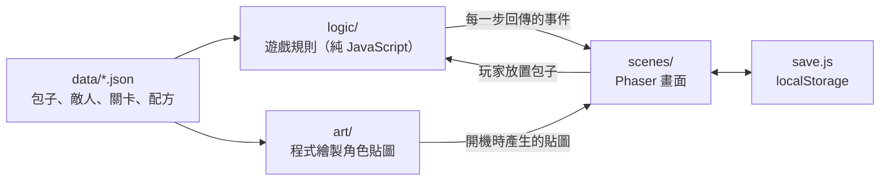
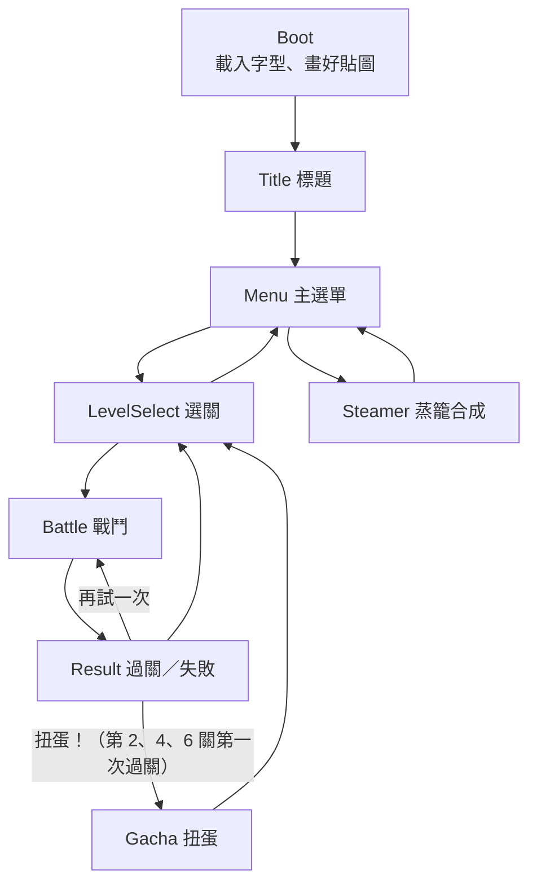

# 包包早餐店保衛戰（baobao）

*   **Author:** MengChiehLiu
*   **Status:** Approved
*   **Date:** 2026-11-14

--------------------------------------------------------------------------------

## Overview

這是一款給女朋友玩的單機塔防遊戲，共 10 關，用手機或電腦的瀏覽器就能玩。

- **玩法：** 早餐店裡有 5 條直線車道。她在車道上放可愛的包子和饅頭，擋住來偷吃的螞蟻、老鼠、蟑螂和鴿子。每種包子的攻擊方式不同：小籠包會噴熱湯、流沙包會留下讓敵人變慢的水灘、刈包會夾住敵人。
- **特殊包子：** 共 5 種。過特定關卡後，可以從扭蛋拿到 3 種，用蒸籠合成食材拿到 2 種。
- **畫面：** 日系可愛風格。角色、背景和介面全部用程式繪製，可愛感主要來自動作，例如壓扁彈起、輕晃、冒蒸氣。
- **技術：** 遊戲用 JavaScript 和 Phaser 引擎製作，放在 GitHub Pages 上。

## The Problem

她想玩一款可愛、好看、不會太難的塔防遊戲。現有的塔防遊戲不是為她做的：主題跟她無關，很多還有付費抽卡或體力限制。

開發者主要寫 Python，沒做過遊戲，也不會畫畫。程式碼由 AI 助理撰寫，開發者負責檢查程式碼、調整 JSON 數值和試玩。這份設計要解決三件事：

1. **美術：** 開發者不會畫畫，畫面仍要有日系可愛感。解法是用程式畫圓潤的角色，搭配固定色票和 Q 彈的動作。
2. **工作量：** 這是興趣專案，不能做太久。解法有兩個：包子、敵人和關卡都寫成資料；包子的特殊效果由 5 個共用的「效果零件」組合，不用每種包子各寫一套程式。
3. **裝置：** 手機和電腦都要能玩，而且不用安裝。解法是做成網頁遊戲，以橫向手機畫面和點擊操作為主。

## Goals

*   **玩得完 10 關：** 每關最多加入 1 種新包子和 1 種新敵人，用關卡本身教玩法。
*   **難度輕鬆：** 她不需要開發者解釋，就能自己玩到第 10 關。可以輸；輸了點一下「再試一次」，2 秒內重新開始同一關。
*   **只用基本包子就能過每一關：** 特殊包子讓玩法有變化，但不是過關的必要條件。所以時間不夠時，可以先砍扭蛋和蒸籠。
*   **基本包子各有不同行為：** 5 種基本包子的攻擊方式都不一樣，不只是數值不同：
    *   白饅頭：擋路
    *   叉燒包：射擊
    *   小籠包：噴湯
    *   流沙包：減速
    *   刈包：夾住
*   **特殊包子（5 種）：**
    *   **扭蛋包子（3 種）：** 第 2、4、6 關第一次過關時各扭到 1 種，順序固定。
    *   **合成包子（2 種）：** 用過關得到的**食材**在蒸籠裡合成。
*   **4 種敵人：** 螞蟻、老鼠、蟑螂、鴿子。鴿子會飛，所有包子都擋不住牠。
*   **畫面好看：**
    *   日系可愛風格。
    *   每種包子都有放下、待機、攻擊、受傷的動畫。
    *   每種包子的輪廓都不同。
    *   高解析度手機上邊緣清楚。
*   **手機和電腦都能玩：** 效能目標見 Non-Functional Requirements；所有操作都能用點擊完成。
*   **調數值不用改程式：** 包子、敵人和關卡的數值都在 JSON 檔裡。

## Non-Goals

*   **收集或圖鑑系統。**
*   **真錢付費、體力限制、帳號、伺服器、多人連線。**
*   **存檔匯出和跨裝置同步：** 存檔只放在瀏覽器裡。只做最基本的防護（見 Technical Plan 第 7 節）。
*   **迷宮式塔防：** 不做需要尋路的設計，敵人只沿直線車道前進。
*   **外部插圖或 AI 生成圖片：** 所有美術都用程式繪製。
*   **獨立的美術預覽頁：** 美術直接在遊戲裡調整。
*   **原生 App 或上架商店。**
*   **直向畫面：** 手機直拿時只顯示「請轉橫」提示。
*   **聲音：** 第一版沒有音效和音樂。
*   **加速：** 沒有 2 倍速，只有暫停。
*   **第一版不做的包子：** 榴槤包、麻糬包、花捲。

## Open Questions

*   **她的手機型號：** 目前以 iPhone SE（第 2 代）的 Safari 當最低標準設計。如果她的手機更舊或更小，再調整效能和按鈕大小。

## Critical User Journeys (CUJs)

### CUJ 1：第一次打開遊戲並過第一關

*   **Given**：手機已經把遊戲加到主畫面，而且是橫著拿。
*   **When**：她從主畫面圖示打開遊戲，點「開始」，再點「出發」，然後選第 1 關。進到關卡後，她先點下方的叉燒包卡片，再點一個格子。
*   **Then**：
    *   叉燒包放下時會壓扁再彈起，並自動射擊來的螞蟻。
    *   所有波次的敵人都打倒後，出現過關畫面。

### CUJ 2：輸了重來

*   **Given**：她在第 5 關，已經有 3 隻敵人走到櫃台。
*   **When**：畫面出現「被偷吃了！」，她點「再試一次」。
*   **Then**：2 秒內重新開始同一關。

### CUJ 3：過關後扭到扭蛋包子

*   **Given**：她第一次打贏第 2 關。
*   **When**：她在過關畫面點「扭蛋！」。
*   **Then**：
    *   扭蛋機轉動，掉出一顆扭蛋。扭蛋打開後，芋頭包跳出來，並顯示名稱和說明。
    *   從下一場戰鬥開始，芋頭包會出現在卡片列。

### CUJ 4：在蒸籠合成新包子

*   **Given**：她已經打贏第 4 關，手上有起司和鹹蛋黃。
*   **When**：她在主選單點「蒸籠」，把起司和鹹蛋黃放進蒸籠，然後點「蒸！」。
*   **Then**：
    *   起司流沙小籠包跳出來，從此永久解鎖。
    *   如果配方不對，會跑出一顆「失敗的醜包子」，食材全部退回。

## Technical Plan (Architecture)

本節只用文字描述規則；所有數字、表格和配方都在 Detailed Implementation Plan 的第 0 節。

**用詞：**

| 詞 | 意思 |
|---|---|
| 格 | 場地上的格子 |
| 幀 | 畫面每秒更新的次數 |
| 步 | 遊戲規則的一次更新 |
| 蒸氣值 | 戰鬥中放包子要花的資源。「蒸氣」只指冒煙的特效 |
| 遊戲像素 | 960×540 座標系統裡的單位 |

### 1. 技術選擇

| 項目 | 選擇 | 原因 |
|---|---|---|
| 遊戲引擎 | Phaser 3（固定 3.90.0），使用 WebGL 渲染 | 內建補間動畫、粒子、畫面縮放和觸控，不必自己寫 |
| 語言 | JavaScript，資料結構用 JSDoc 註解 | 少一個編譯步驟 |
| 打包 | Vite | 開發時改了程式會自動重新整理，也能打包成靜態網站 |
| 網站 | GitHub Pages，用 GitHub Actions 自動部署 | 免費，網址固定 |
| 周邊工具 | Python（裁切字型、產生主畫面圖示） | 開發者熟悉 |

### 2. 程式分三層



*   **data：** 所有數值和內容。
*   **logic：** 遊戲規則。
    *   不引用 Phaser，可以單獨測試。
    *   每步固定 1/60 秒。
    *   亂數由外部傳入的種子產生，所以同樣的種子加上同樣的操作，結果完全相同。
    *   每一步回傳這一步發生的事件，例如「小籠包噴湯」「敵人被打倒」，由畫面層播放動畫。
*   **art：** 開機時依外觀參數畫好所有貼圖。
*   **scenes：** Phaser 的各個畫面。
*   **save.js：** 讀寫存檔。

調整畫面時不需要改規則層的程式碼。

### 3. 畫面流程



*   除了戰鬥中，每個畫面左上角都有「返回」按鈕。
*   戰鬥中可以暫停，暫停選單裡有「回選關」。
*   手機直拿時，畫面上蓋一層「請轉橫」提示，戰鬥同時自動暫停。

### 4. 戰鬥規則

**場地：** 橫向 5 條車道 × 9 格。櫃台在左邊，敵人從右邊出現往左走。

**放包子：**
*   放包子要花蒸氣值。蒸氣值會隨時間增加，打倒敵人也會增加。
*   操作方式：先點下方的卡片，再點一個空格子。
*   卡片列顯示所有已解鎖的包子，沒有攜帶數量上限。
*   放下後，這張卡片要冷卻一段時間才能再用。

**包子：** 每種包子是一筆資料，列出它用到哪些效果零件。

| 零件 | 做什麼 |
|---|---|
| `shoot` | 同一條車道前方有敵人時，往前發射子彈；子彈打中時可以觸發其他零件 |
| `splash` | 打中時，對附近一定半徑內的其他敵人造成傷害；半徑夠大時會打到隔壁車道 |
| `puddle` | 在打中的位置留下一塊水灘，地面敵人走過時會變慢 |
| `clamp` | 夾住前方一格內的一隻敵人，讓牠停住並持續受傷；放開後要等一段時間才能再夾 |
| `block` | 不攻擊，只是血量很高 |

**敵人和包子的互動：**
*   每個包子都會擋住地面敵人。敵人被擋住時會停下來咬包子，包子血量歸零就消失。
*   被夾住的敵人不能移動，也不能咬。
*   多個減速效果重疊時，只取最強的一個。
*   會飛的敵人（鴿子）不會被任何包子擋住，也不受水灘影響，但會被子彈、濺射和夾子打到。
*   有 3 隻敵人走到櫃台就算輸；在同一步裡，先判斷輸再判斷贏。
*   所有波次的敵人都出現過、而且場上已經沒有敵人時，就算過關。

**波次：**
*   每一波開始前，畫面右邊會先預告 2 秒，顯示這波有哪些敵人。
*   一波裡的敵人每隔固定秒數出現一隻，出現的車道由亂數決定。
*   這一波的敵人全部被打倒或走到櫃台後，才開始下一波的預告。

### 5. 解鎖

*   **基本包子：** 進入某一關時，自動解鎖這關的新包子並存檔。
*   **扭蛋包子：** 第 2、4、6 關第一次過關時，依固定順序解鎖下一種扭蛋包子並存檔，再到扭蛋畫面播放動畫。
*   **食材：** 特定關卡第一次過關時給固定的食材。
*   **合成包子：** 在蒸籠合成成功時解鎖。
*   **蒸籠開放：** 主選單的「蒸籠」按鈕在第 4 關過關後才開放。

### 6. 蒸籠合成

*   把兩種食材放進蒸籠，點「蒸！」。
*   配方固定，放的順序不影響結果。
*   配方對就扣掉兩種食材各 1 個，並解鎖包子。
*   配方錯時跑出醜包子，不扣食材。
*   合成結果是已經擁有的包子時，不扣食材，並顯示「已經有了」。
*   點已經放了食材的格子，可以把食材拿出來。
*   畫面右邊顯示還沒解鎖的合成包子剪影和一行提示。

### 7. 存檔

*   **存在哪裡：** 存在瀏覽器的 `localStorage`。
*   **讀取：** 讀取時把存檔和預設值合併，所以之後新增欄位也不會讓舊存檔失效。只有存檔無法解析時，才換成新存檔。
*   **iOS 防護：** iPhone Safari 7 天沒造訪網站時，可能會清掉資料。所以網頁要支援「加到主畫面」，並在第一次點擊時要求瀏覽器保留資料。開發者會親自幫她把遊戲加到主畫面，之後都從圖示打開。
*   **存取失敗：** 存取失敗時遊戲照常進行，只是不會保存進度。

### 8. 美術與動畫

*   **畫布清晰度：** 畫布實際大小 = 960×540 × 縮放倍率，縮放倍率 = min(裝置像素比, 2)。鏡頭放大同樣倍率，所以座標仍然是 960×540。
*   **貼圖：**
    *   貼圖依同樣的倍率繪製，顯示時再縮回原大小，所以在高解析度手機上邊緣也清楚。
    *   每種包子、敵人和食材都用一組外觀參數描述，同一個繪圖函式依參數畫出貼圖。
*   **色票：** 只用固定的 12 色。外框是深咖啡色。
*   **動畫：** 放下、待機呼吸、眨眼、攻擊前蓄力、受傷、敵人消失都用補間動畫。時間和幅度先寫成程式常數，之後在遊戲裡調整。
*   **特效：** 冒蒸氣、湯汁、星星、愛心、彩紙都用粒子特效。
*   **字型：** 使用 jf 粉圓體，只保留遊戲裡用到的字。

### 9. 手機支援

*   按鈕至少 72 遊戲像素。在 iPhone SE 上約 50 螢幕像素。
*   設定 `touch-action: none`，避免點擊時畫面被放大。

## Risks

1. **iOS 清除存檔。** 7 天沒開可能被清。**已處理：** 加到主畫面並要求保留資料（第 7 節）。萬一還是不見，可以用開發用的解鎖參數補回進度。
2. **不知道她的手機型號。** **已處理：** 以 iPhone SE 為最低標準，並限制粒子數量。
3. **畫面清晰度。** **已處理：** 依裝置像素比放大畫布（第 8 節）。第一個開發階段就在手機上確認。
4. **難度很晚才知道合不合適。** **接受。** 開發者會自己只用基本包子把每關玩一遍；要調整就改 JSON。
5. **GitHub repo 公開。** **接受。** 原始碼和網址是公開的。私人梗如果太私密，就不要放進遊戲。

## Alternatives Considered

### Alternative A：以收集為核心的遊戲

*   **Pros**：可以一直收集，玩得比較久。
*   **Cons**：要做圖鑑、配方書和大量收藏品，工作量至少多一倍，而且重心會離開塔防。
*   **否決原因**：她要的是塔防。收集系統的成本高，而塔防不需要它。

### Alternative B：用 Python 做（pygame + pygbag）

*   **Pros**：開發者看得懂、改得動。
*   **Cons**：
    *   網頁版要先下載整個 Python 執行環境，檔案好幾 MB。
    *   在手機瀏覽器上比較不成熟。
    *   預設繪圖的圓形邊緣有鋸齒。
*   **否決原因**：跟「畫面好看」和「手機能玩」兩個目標衝突。程式碼既然由 AI 助理寫，語言熟悉度的好處就變小了。

### Alternative C：用 Godot 做

*   **Pros**：有編輯器和動畫工具，GDScript 語法像 Python。
*   **Cons**：網頁版約 8–10 MB，較舊的 iPhone 可能記憶體不足；開發者還要學編輯器。
*   **否決原因**：學編輯器的時間在「玩一下」的專案裡不划算，而且檔案大小和記憶體都比 Phaser 高。

### Alternative D：用外部插圖或 AI 生成圖片

*   **Pros**：馬上就有手繪的日系感，細節比程式繪製多。
*   **Cons**：
    *   奇葩包子不容易找到現成的圖。
    *   不同來源的畫風難以統一。
    *   靜態圖做不出壓扁彈起這類變形動畫。
    *   要逐一確認授權。
*   **否決原因**：程式繪製的風格一致，新增包子也不受素材限制。代價是細節比較少，用動作彌補。

### Alternative E：先做美術預覽頁

*   **Pros**：寫遊戲之前就能在手機上看到造型和動畫。
*   **Cons**：要多維護一個入口。開機畫面本來就會畫出所有貼圖，所以預覽頁並不會讓美術改得比較快。
*   **否決原因**：好處跟成本差不多。改用開發順序裡的第 3 階段在手機上確認美術。

### Alternative F：只做扭蛋，或只做合成

*   **Pros**：少一個畫面、一個資料檔和一組測試。
*   **Cons**：取得特殊包子的方式只剩一種。
*   **否決原因**：兩種都做的成本，主要是多一個畫面。因為每關只用基本包子就能過，時間不夠時這兩個畫面可以最先砍掉，不影響主線。

### Alternative G：所有包子只差在數值

*   **Pros**：最容易做。
*   **Cons**：拿到新包子時沒有驚喜。
*   **否決原因**：基本包子和合成包子都要有不同的行為。扭蛋包子是例外，刻意做成數值和外觀不同的變體，以控制工作量。

### Alternative H：自由路徑或迷宮式塔防

*   **Pros**：路線可以彎曲，場地比較有變化。
*   **Cons**：需要尋路，擋路和夾住這類效果在彎路上很難做，手機上也不好點選位置。
*   **否決原因**：直線車道讓每種效果都只是「同一條車道上的位置計算」，工作量少很多。

### Alternative I：完整存檔保護（匯出碼、多個存檔欄位、跨裝置同步）

*   **Pros**：換手機或清掉資料時也不會不見。
*   **Cons**：要多做匯出／匯入畫面和存檔管理。
*   **否決原因**：存檔只有約 3 個欄位，內容也不多。完整保護的成本比遺失的損失大。改用第 7 節的基本防護。

### Alternative J：不能輸，只用星星評分

*   **Pros**：永遠不會卡關。
*   **Cons**：沒有塔防的緊張感。
*   **否決原因**：她指定要塔防。改用「點一下就重來」降低輸的挫折。

### Alternative K：分階段交付，先給她玩 3 關試玩版

*   **Pros**：很早就知道難度和手感合不合她的口味。
*   **Cons**：要多一次中途交付，有些畫面可能做兩次。
*   **否決原因**：作者選擇做完再給她玩。內部仍然照開發順序做，每個階段由開發者自己試玩確認。

### Alternative L：包子券、隨機掉落食材、最多帶 6 種包子

*   **Pros**：比較有一般手遊的感覺。
*   **Cons**：
    *   3 張券、3 種包子又不重複，結果其實是固定的。
    *   隨機掉落可能逼她重刷舊關卡。
    *   攜帶上限可能把該關要教的新包子排除在外。
*   **否決原因**：作者採納審查建議，改成固定獎勵、不設攜帶上限。

--------------------------------------------------------------------------------

## Non-Functional Requirements

*   **效能：** 在 iPhone SE（第 2 代）上，目標每秒 60 幀；第 10 關最後一波時，每秒至少 30 幀。粒子總數上限 200 個，由各個粒子發射器分配。戰鬥中不重畫貼圖。
*   **載入：** 第一次載入（包括字型）在 4G 網路下 5 秒內完成。裁切後的字型小於 300 KB。
*   **隱私：** 沒有帳號，沒有追蹤，不會傳任何資料到伺服器。

## Future Improvements

*   新包子：榴槤包（讓敵人掉頭）、麻糬包（黏住並串連敵人）、花捲（旋轉攻擊）。
*   音效和背景音樂。
*   兩人之間的私人梗，例如用在包子或配方的名字。

--------------------------------------------------------------------------------

## Detailed Implementation Plan

### 0. 數值與內容（唯一的數字來源）

下列數值都是起始值，寫在 JSON 或 `src/config.js` 裡，之後依試玩結果調整。

#### 0.1 座標

座標系統是 960×540 遊戲像素。

| 區域 | 位置 |
|---|---|
| 上方資訊列：蒸氣值、波次、到達櫃台數、暫停 | y 0–60 |
| 戰場：車道 0–4 由上到下，欄 0–8 由左到右，每格 80×80 | x 120–840，y 60–460 |
| 第 c 欄的中心 | x = 160 + 80c |
| 第 r 條車道的中心 | y = 100 + 80r |
| 櫃台 | x 0–120 |
| 敵人出生點 | x 880 |
| 卡片列：每張卡片 84×72，間隔 6，最多 10 張 | y 464–536 |

#### 0.2 戰鬥機制

*   **時間：**
    *   每步 1/60 秒。
    *   畫面每幀最多跑 5 步；超過上限時，丟掉多出來的時間。
    *   分出輸贏後就停止推進。
*   **蒸氣值：**
    *   開場 100。
    *   遊戲時間每滿 4.0 秒加 25。
    *   每打倒一隻敵人加 5。
    *   沒有上限。
*   **卡片：** 開場時所有卡片都可以用。放下包子後開始冷卻。
*   **子彈：**
    *   從 x = 包子.x + 30 射出，以每秒 300 像素往右飛。
    *   遇到同車道、x 差距在 20 以內的第一個敵人，就算打中，子彈消失。
    *   飛超過 x 860 時，子彈消失，不會觸發任何效果。
*   **發射條件：** 同車道上有任何敵人，且敵人的 x 大於包子的 x、小於等於 840。
*   **敵人：**
    *   半寬 20。
    *   地面敵人在同車道上滿足「敵人.x − 20 ≤ 包子.x + 40」而且「敵人.x > 包子.x」時被擋住，並咬最右邊的那個包子。
    *   敵人的 x ≤ 120 時算到達櫃台，會被移除，到達數加 1。
*   **輸贏：** 到達數 ≥ 3 判輸，先判輸再判贏。所有波次都出完、場上沒有敵人時判贏。
*   **濺射：**
    *   以打中點 (子彈.x, 車道中心 y) 為圓心，計算平面距離。
    *   主要目標只受子彈傷害；半徑內的其他敵人受濺射傷害。
*   **水灘：**
    *   以打中點的 x 為中心，寬 80，只在同一條車道。
    *   地面敵人的 x 在範圍內時，速度乘上減速倍率。
    *   多個水灘重疊時，取最小的倍率。
*   **夾子：**
    *   目標是同車道上 x 在 (包子.x, 包子.x + 80] 之間、x 最小的敵人。
    *   夾住期間，敵人速度為 0，不咬，每秒受傷。
    *   夾子放開或目標死亡後，開始計算「再夾間隔」。
    *   被放開的敵人 1 秒內不能再被任何包子夾住。
*   **會飛的敵人：** 不跟任何包子碰撞，也不受水灘影響。
*   **波次：**
    *   第 1 秒開始預告第 1 波；第 3 秒第 1 波的第一隻敵人出現。
    *   之後每隔「出怪間隔」秒出現一隻。出現順序和車道由這場戰鬥的亂數決定，車道只從該關開放的車道中選。
    *   前一波的敵人全部出完、而且都被打倒或到達櫃台後，開始預告下一波：預告 2 秒，然後出現第一隻敵人。
*   **亂數種子：** 每場戰鬥開始時，種子 = `Date.now() >>> 0`。

#### 0.3 包子

以下「冷卻」都是指卡片冷卻。

| id | 名稱 | 類別 | 蒸氣值 | 冷卻 | 血量 | 效果 |
|---|---|---|---|---|---|---|
| `charsiu` | 叉燒包 | 基本 | 50 | 5 秒 | 100 | `shoot`：傷害 20，每 1.5 秒 |
| `mantou` | 白饅頭 | 基本 | 50 | 20 秒 | 600 | `block` |
| `xiaolong` | 小籠包 | 基本 | 125 | 8 秒 | 100 | `shoot`：傷害 15，每 2 秒；打中時 `splash`：半徑 60、傷害 15 |
| `liusha` | 流沙包 | 基本 | 100 | 8 秒 | 100 | `shoot`：傷害 10，每 2 秒；打中時 `puddle`：寬 80、持續 2 秒、速度 ×0.5 |
| `guabao` | 刈包 | 基本 | 150 | 10 秒 | 150 | `clamp`：夾 3 秒，每秒傷害 30，再夾間隔 4 秒 |
| `taro` | 芋頭包 | 扭蛋 | 100 | 5 秒 | 100 | `shoot`：傷害 30，每 1.5 秒 |
| `brownsugar` | 黑糖饅頭 | 扭蛋 | 100 | 20 秒 | 1000 | `block` |
| `charcoal` | 竹炭包 | 扭蛋 | 150 | 8 秒 | 100 | 同小籠包，但 `splash` 半徑 90（會打到隔壁車道） |
| `cheeseliusha` | 起司流沙小籠包 | 合成 | 175 | 10 秒 | 100 | `shoot`：傷害 15，每 2 秒；打中時 `splash`：半徑 60、傷害 15；加上 `puddle`：寬 80、2 秒、×0.5 |
| `chiliguabao` | 辣椒刈包 | 合成 | 175 | 10 秒 | 150 | `clamp`：夾 4 秒，每秒傷害 50，再夾間隔 4 秒；放開時 `splash`：半徑 60、傷害 40 |

扭蛋解鎖順序固定為：`taro` → `brownsugar` → `charcoal`。

`effects` 欄位的 JSON 格式以流沙包為例：

```json
[{"type":"shoot","damage":10,"interval":2,
  "onHit":[{"type":"puddle","width":80,"duration":2,"slow":0.5}]}]
```

`clamp` 用 `onRelease` 欄位掛上放開時觸發的零件，格式和 `onHit` 相同。

#### 0.4 敵人

| id | 名稱 | 血量 | 速度（像素／秒） | 咬（每秒傷害） | 會飛 |
|---|---|---|---|---|---|
| `ant` | 螞蟻 | 60 | 20 | 10 | 否 |
| `mouse` | 老鼠 | 150 | 15 | 20 | 否 |
| `roach` | 蟑螂 | 100 | 35 | 15 | 否 |
| `pigeon` | 鴿子 | 250 | 18 | 0 | 是 |

#### 0.5 關卡

| 關卡 | 開放車道 | 新包子 | 新敵人 | 出怪間隔 | 第一次過關獎勵 |
|---|---|---|---|---|---|
| 1 | 1, 2, 3 | 叉燒包 | 螞蟻 | 4.0 秒 | — |
| 2 | 1, 2, 3 | 白饅頭 | — | 3.5 秒 | 扭蛋：芋頭包 |
| 3 | 0–4 | 小籠包 | 老鼠 | 3.5 秒 | — |
| 4 | 0–4 | — | — | 3.0 秒 | 扭蛋：黑糖饅頭；起司 ×1、鹹蛋黃 ×1 |
| 5 | 0–4 | 流沙包 | — | 3.0 秒 | — |
| 6 | 0–4 | — | 蟑螂 | 3.0 秒 | 扭蛋：竹炭包 |
| 7 | 0–4 | 刈包 | — | 2.5 秒 | 辣椒 ×1、滷肉 ×1 |
| 8 | 0–4 | — | — | 2.5 秒 | — |
| 9 | 0–4 | — | 鴿子 | 2.5 秒 | — |
| 10 | 0–4 | — | — | 2.0 秒 | — |

**波次內容：**

| 關卡 | 第 1 波 | 第 2 波 | 第 3 波 | 第 4 波 | 第 5 波 | 第 6 波 |
|---|---|---|---|---|---|---|
| 1 | 螞蟻 3 | 螞蟻 5 | | | | |
| 2 | 螞蟻 4 | 螞蟻 6 | | | | |
| 3 | 螞蟻 5 | 螞蟻 4、老鼠 2 | 螞蟻 5、老鼠 3 | | | |
| 4 | 螞蟻 4、老鼠 2 | 螞蟻 5、老鼠 3 | 螞蟻 6、老鼠 4 | | | |
| 5 | 螞蟻 5、老鼠 3 | 螞蟻 6、老鼠 4 | 螞蟻 7、老鼠 5 | | | |
| 6 | 螞蟻 5、蟑螂 2 | 螞蟻 4、老鼠 3、蟑螂 2 | 螞蟻 5、老鼠 4、蟑螂 3 | 螞蟻 6、老鼠 4、蟑螂 4 | | |
| 7 | 螞蟻 5、老鼠 3、蟑螂 2 | 螞蟻 6、老鼠 4、蟑螂 3 | 螞蟻 6、老鼠 5、蟑螂 4 | 螞蟻 8、老鼠 5、蟑螂 5 | | |
| 8 | 螞蟻 6、老鼠 4、蟑螂 3 | 螞蟻 7、老鼠 5、蟑螂 4 | 螞蟻 8、老鼠 5、蟑螂 5 | 螞蟻 8、老鼠 6、蟑螂 6 | | |
| 9 | 螞蟻 5、老鼠 3、鴿子 1 | 螞蟻 6、老鼠 4、蟑螂 3、鴿子 2 | 螞蟻 7、老鼠 5、蟑螂 4、鴿子 2 | 螞蟻 8、老鼠 5、蟑螂 5、鴿子 3 | 螞蟻 8、老鼠 6、蟑螂 6、鴿子 3 | |
| 10 | 螞蟻 8、老鼠 4 | 老鼠 6、蟑螂 5 | 螞蟻 10、蟑螂 5、鴿子 2 | 螞蟻 8、老鼠 6、蟑螂 5、鴿子 3 | 螞蟻 10、老鼠 6、蟑螂 6、鴿子 4 | 螞蟻 12、老鼠 8、蟑螂 8、鴿子 5 |

`levels.json` 裡每一波寫成 `{ "ant": 3, "mouse": 2 }` 這樣的數量表，這張表是唯一的來源。

#### 0.6 食材與配方

| 食材 id | 名稱 |
|---|---|
| `cheese` | 起司 |
| `saltedegg` | 鹹蛋黃 |
| `chili` | 辣椒 |
| `braisedpork` | 滷肉 |

| 食材 | 結果 | 提示 |
|---|---|---|
| `cheese` + `saltedegg` | 起司流沙小籠包 | 「會牽絲的 + 會爆漿的」 |
| `chili` + `braisedpork` | 辣椒刈包 | 「辣辣的 + 滷得香香的」 |

同一種食材放兩次：持有數量要 ≥ 2 才能放，而且一定失敗。

#### 0.7 色票

| 名稱 | 色碼 | 用途 |
|---|---|---|
| `cream` | `#FFF6E5` | 背景、面板 |
| `dough` | `#F7E7CE` | 包子麵皮 |
| `wood` | `#E8CDA8` | 地板、櫃台 |
| `caramel` | `#D9A066` | 叉燒、焦糖色 |
| `yolk` | `#F7C948` | 流沙、蛋黃 |
| `sakura` | `#F6B8C8` | 按鈕、愛心 |
| `blush` | `#F49AA8` | 腮紅 |
| `matcha` | `#A8C99A` | 刈包菜、提示 |
| `taro` | `#C3A6D8` | 芋頭包 |
| `chili` | `#E5674E` | 辣椒、警告 |
| `charcoal` | `#5E5A5A` | 竹炭包 |
| `outline` | `#6B4A3A` | 所有外框和文字 |

#### 0.8 外觀參數（`look`）

| 欄位 | 可選值 |
|---|---|
| `body` | `round`、`oval`、`square`、`folded` |
| `pleats` | 0–12 的整數 |
| `top` | `none`、`twist`、`dot`、`crack` |
| `color`、`filling` | 色票名稱；`filling` 也可以是 `null` |
| `topping` | `none`、`sesame`、`leaf`、`cheese`、`chili` |
| `face` | `smile`、`open`、`sleepy` |

敵人和食材使用同樣的 `color` 和 `face` 欄位，加上 `kind`（敵人的 id 或食材的 id），決定要畫哪一種輪廓。

#### 0.9 存檔格式

```json
{ "cleared": [1, 2], "unlockedBuns": ["charsiu", "mantou", "taro"], "ingredients": { "cheese": 1 } }
```

新存檔是 `{ cleared: [], unlockedBuns: ["charsiu"], ingredients: {} }`，鍵名為 `baobao:save`。

### 1. 開發順序

每個階段結束時，`npm test` 和 `npm run build` 都要通過。

| 階段 | 內容 | 完成條件 |
|---|---|---|
| 1 | 專案骨架、`rng`、`save`、資料檔、資料測試 | 測試通過，建置成功 |
| 2 | `effects`、`battle` 和它們的測試 | 戰鬥測試通過 |
| 3 | 美術（`art/`）、`BootScene`、`TitleScene`、主畫面圖示 | 在她的手機型號上，貼圖邊緣清楚、字型正確 |
| 4 | `MenuScene`、`LevelSelectScene`、`BattleScene`、`ResultScene` | 開發者只用基本包子能打完第 1–10 關 |
| 5 | `GachaScene`、`SteamerScene`、`gacha`、`fusion` | 扭蛋和合成流程能走完 |
| 6 | 字型裁切、部署流程 | 手機從 GitHub Pages 網址打開，驗證清單全部通過 |

### 2. 專案設定

#### 1. `package.json`（Create）
*   **Type / Scope**：npm 專案設定
*   **Proposed Changes**：
    *   `"private": true`、`"type": "module"`。
    *   相依套件：`phaser@3.90.0`。開發用：`vite@6`、`vitest@3`。
    *   指令：
        *   `dev: vite`
        *   `build: vite build`
        *   `preview: vite preview`
        *   `test: vitest run`

#### 2. `package-lock.json`（Create）
*   **Type / Scope**：鎖定版本
*   **Proposed Changes**：由 `npm install` 產生並加入版本控制，`npm ci` 需要它。

#### 3. `vite.config.js`（Create）
*   **Type / Scope**：打包設定
*   **Proposed Changes**：`base: '/baobao/'`，對應 GitHub Pages 的網址路徑；這要求 repo 名稱是 `baobao`。

#### 4. `index.html`（Create）
*   **Type / Scope**：網頁入口
*   **Proposed Changes**：
    *   `viewport` 設定 `width=device-width, initial-scale=1, viewport-fit=cover`。
    *   加上 `apple-mobile-web-app-capable` 和 `apple-touch-icon`（指向 `icons/icon-192.png`），並連結 `manifest.webmanifest`。
    *   「請轉橫」提示是一個 HTML 區塊，在 CSS `(orientation: portrait)` 時顯示，文字是「請把手機轉橫」。

#### 5. `src/style.css`（Create）
*   **Type / Scope**：全域樣式
*   **Proposed Changes**：
    *   用 `@font-face` 宣告 `font-family: 'BaobaoRounded'`，以相對路徑 `url('./assets/fonts/baobao-rounded.woff2')` 載入字型，讓 Vite 依 `base` 處理網址；設定 `font-display: block`。
    *   `html`、`body` 和 canvas 都設定 `touch-action: none`，背景色為 `#FFF6E5`。
    *   「請轉橫」提示的樣式。
    *   由 `main.js` 匯入這個檔案。

#### 6. `public/manifest.webmanifest`（Create）
*   **Type / Scope**：加到主畫面的設定
*   **Proposed Changes**：
    *   `name`、`short_name`：「包包保衛戰」。
    *   `display: "fullscreen"`、`orientation: "landscape"`。
    *   `start_url: "./"`、`background_color: "#FFF6E5"`。
    *   圖示 192 和 512。

#### 7. `public/icons/icon-192.png`、`public/icons/icon-512.png`（Create）
*   **Type / Scope**：主畫面圖示
*   **Proposed Changes**：由第 40 項的工具產生，畫一顆有臉的叉燒包，並加入版本控制。

#### 8. `.gitignore`（Create）
*   **Type / Scope**：Git 設定
*   **Proposed Changes**：忽略以下項目：
    *   `node_modules/`、`dist/`
    *   `__pycache__/`、`*.pyc`、`.venv/`
    *   `src/assets/fonts/baobao-rounded.woff2`（每次由工具產生）

#### 9. `.github/workflows/deploy.yml`（Create）
*   **Type / Scope**：自動部署
*   **Proposed Changes**：
    *   推送到 `main` 時觸發。
    *   權限：`contents: read`、`pages: write`、`id-token: write`。
    *   `concurrency: pages`。
    *   **build 工作：**
        1.  `actions/checkout`
        2.  `actions/setup-node`（Node 22，npm 快取）
        3.  `actions/setup-python`（3.12）
        4.  `pip install -r tools/requirements.txt`
        5.  `python tools/subset_font.py`
        6.  `npm ci`
        7.  `npm test`
        8.  `npm run build`
        9.  `actions/configure-pages`
        10. `actions/upload-pages-artifact`（路徑 `dist`）
    *   **deploy 工作：** `actions/deploy-pages`，設定 `environment: github-pages`。
    *   各個 action 實作時使用當時的最新主版本。

#### 10. `README.md`（Create）
*   **Type / Scope**：說明文件
*   **Proposed Changes**：
    *   本機執行：`pip install -r tools/requirements.txt`、`python tools/subset_font.py`、`npm install`、`npm run dev`。
    *   用手機連線測試：`npm run dev -- --host`，手機和電腦連同一個 Wi-Fi。
    *   開發用網址參數（見第 25 項）。
    *   怎麼調整 JSON 數值。
    *   第一次部署前，要到 GitHub 的 Settings → Pages，把 Source 設成「GitHub Actions」；repo 名稱必須是 `baobao`。
    *   怎麼在她的手機上「加到主畫面」。

### 3. 資料

#### 11. `src/data/buns.json`（Create）
*   **Type / Scope**：包子資料
*   **Proposed Changes**：每種包子一筆，欄位如下，數值依 0.3：
    *   `id`、`name`
    *   `desc`：一行說明，扭蛋畫面和卡片會用到
    *   `source`：`base`、`gacha` 或 `fusion`
    *   `cost`、`cardCooldown`、`hp`、`effects`
    *   `look`：格式依 0.8
    *   `hint`：只有合成包子有

    檔案裡的順序就是卡片列的順序：基本包子在前，接著扭蛋包子，最後合成包子。

#### 12. `src/data/enemies.json`（Create）
*   **Type / Scope**：敵人資料
*   **Proposed Changes**：欄位有 `id`、`name`、`hp`、`speed`、`bite`、`flying`、`look`，數值依 0.4。

#### 13. `src/data/levels.json`（Create）
*   **Type / Scope**：關卡資料
*   **Proposed Changes**：每關的欄位如下，內容依 0.5：
    *   `id`、`lanes`、`newBuns`、`newEnemies`、`gap`
    *   `waves`：數量表的陣列
    *   `firstClear`：`{ gacha: true|false, ingredients: { id: 數量 } }`

#### 14. `src/data/ingredients.json`、`src/data/recipes.json`（Create）
*   **Type / Scope**：食材與配方
*   **Proposed Changes**：內容依 0.6。食材有 `id`、`name`、`look`；配方有 `inputs`（2 個食材 id）和 `result`。

#### 15. `src/data/strings.json`（Create）
*   **Type / Scope**：介面文字
*   **Proposed Changes**：
    *   按鈕、標題和提示的文字，例如「開始」「出發」「蒸籠」「再試一次」「被偷吃了！」「扭蛋！」「已經有了」「好像哪裡怪怪的…食材還給你」「第 4 關後開放」。
    *   每個失敗原因代碼（見第 17 項）對應的說明文字，例如 `noSteam` →「蒸氣值不夠」。

### 4. 遊戲規則（不引用 Phaser）

#### 16. `src/config.js`（Create）
*   **Type / Scope**：全域常數
*   **Proposed Changes**：
    *   0.1 和 0.2 的所有數值
    *   `FONT_FAMILY = 'BaobaoRounded'`
    *   `MAX_STEPS_PER_FRAME = 5`
    *   `SAVE_KEY = 'baobao:save'`
    *   粒子上限分配：蒸氣 60、湯汁 40、星星 40、愛心 30、彩紙 30

#### 17. `src/logic/types.js`（Create）
*   **Type / Scope**：JSDoc 型別定義
*   **Proposed Changes**：
    *   **`BattleState`：**
        *   `t`、`steam`、`nextSteamAt`、`leaks`
        *   `waveIndex`（從 0 開始）、`wavePhase`（`preview`、`spawning`、`clearing`）、`phaseEndsAt`、`spawnQueue`
        *   `buns`、`enemies`、`bullets`、`puddles`
        *   `cardReadyAt`（包子 id → 時間）
        *   `result`（`null`、`'win'`、`'lose'`）
        *   `nextId`
    *   **單位：**
        *   `BunInstance`：`id`、`defId`、`lane`、`col`、`x`、`hp`、`timers`、`clampTargetId`
        *   `EnemyInstance`：`id`、`defId`、`lane`、`x`、`hp`、`clampedBy`、`noClampUntil`
        *   `Bullet`：`id`、`lane`、`x`、`damage`、`onHit`
        *   `Puddle`：`id`、`lane`、`cx`、`width`、`slow`、`endsAt`
    *   **`BattleEvent`：** 依 `type` 區分，附帶需要的欄位：
        *   `waveStart`（`index`、`counts`）
        *   `spawn`、`shoot`、`hit`、`splash`、`puddle`
        *   `clamp`、`release`、`bite`、`bunDied`、`enemyDied`、`leak`
        *   `win`、`lose`
    *   **回傳格式：** 一律是 `{ ok: true, ... }` 或 `{ ok: false, reason }`。`reason` 只能是：`noSteam`、`cooldown`、`occupied`、`laneClosed`、`notUnlocked`、`notEnough`、`failed`、`owned`。

#### 18. `src/logic/rng.js`（Create）
*   **Type / Scope**：可重現的亂數
*   **Proposed Changes**：`createRng(seed)` 回傳兩個函式：
    *   `next()`：回傳 [0, 1) 之間的數
    *   `pick(array)`：從陣列中隨機挑一個

    用任何可以設定種子的簡單演算法即可。

#### 19. `src/logic/effects.js`（Create）
*   **Type / Scope**：效果零件
*   **Proposed Changes**：
    *   `shoot`、`splash`、`puddle`、`clamp`、`block` 五個零件，規則依 0.2。
    *   每個零件提供 `update(bun, state, dt, emit)`；觸發型的零件提供 `trigger(params, x, lane, state, emit)`，給 `onHit` 和 `onRelease` 使用。
    *   提供 `effectiveSpeed(enemy, state)`：
        *   被夾住或被擋住時為 0。
        *   否則等於基本速度 × 所在水灘的最小倍率；飛行敵人忽略水灘。

#### 20. `src/logic/battle.js`（Create）
*   **Type / Scope**：戰鬥規則
*   **Proposed Changes**：
    *   **`createBattle(level, defs, unlockedBuns, rng)`：** 建立初始狀態。`defs` 是 `{ buns, enemies }`。
    *   **`place(state, bunId, lane, col)`：** 依序檢查以下條件，全部通過就扣蒸氣值、開始卡片冷卻，並回傳 `{ ok: true, bun }`：
        1.  包子已解鎖
        2.  車道有開放
        3.  格子是空的
        4.  卡片已冷卻完畢
        5.  蒸氣值足夠
    *   **`step(state, dt)`：** 推進一步，回傳這一步的事件陣列；不把事件存在狀態裡。順序如下：
        1.  蒸氣值
        2.  波次與出怪
        3.  包子零件
        4.  子彈移動與命中
        5.  水灘到期
        6.  敵人移動、被擋住與咬
        7.  移除死亡的單位
        8.  判斷輸贏

        `result` 不是 `null` 時直接回傳空陣列。

#### 21. `src/logic/gacha.js`（Create）
*   **Type / Scope**：扭蛋解鎖
*   **Proposed Changes**：`nextGachaBun(save, buns)` 依 `buns.json` 的順序，回傳第一個還沒擁有的扭蛋包子 id；全部都有時回傳 `null`。

#### 22. `src/logic/fusion.js`（Create）
*   **Type / Scope**：合成規則
*   **Proposed Changes**：`fuse(save, a, b, recipes)` 依序處理：
    1.  食材不夠時（同一種放兩次則需要 ≥ 2 個），回傳 `notEnough`。
    2.  把兩個食材 id 排序後查配方；查不到時回傳 `failed`，不扣食材。
    3.  結果包子已經擁有時，回傳 `owned`，不扣食材。
    4.  否則扣掉兩種食材各 1 個，回傳 `{ ok: true, save, bunId }`。

#### 23. `src/logic/progress.js`（Create）
*   **Type / Scope**：解鎖與獎勵
*   **Proposed Changes**：
    *   `enterLevel(save, level)`：把 `level.newBuns` 加進 `unlockedBuns`，回傳新的存檔。
    *   `applyWin(save, level, buns)`：
        *   回傳 `{ save, firstClear, gachaBunId, ingredients }`。
        *   第一次過關時，把關卡加進 `cleared`，並加上食材獎勵。
        *   如果這關有扭蛋獎勵，就用 `nextGachaBun` 解鎖下一種扭蛋包子。

#### 24. `src/save.js`（Create）
*   **Type / Scope**：存檔
*   **Proposed Changes**：
    *   `load(storage = globalThis.localStorage)`：
        *   讀取 `SAVE_KEY`，回傳 `{ ...defaultSave(), ...parsed }`。
        *   沒有存檔、無法解析，或存取時拋出錯誤時，回傳 `defaultSave()`。
    *   `save(data, storage = globalThis.localStorage)`：寫入存檔；出錯時不拋出錯誤。
    *   `requestPersist()`：如果瀏覽器有 `navigator.storage.persist`，就呼叫一次。
    *   格式依 0.9。

### 5. 美術

#### 25. `src/main.js`（Create）
*   **Type / Scope**：Phaser 入口
*   **Proposed Changes**：
    *   匯入 `style.css`。
    *   設定 `ZOOM = Math.min(window.devicePixelRatio || 1, 2)`。
    *   Phaser 設定：
        *   `type: Phaser.WEBGL`
        *   `width: 960 * ZOOM`、`height: 540 * ZOOM`
        *   `scale: { mode: Scale.FIT, autoCenter: CENTER_BOTH }`
        *   背景色 `#FFF6E5`
        *   註冊所有畫面
    *   `ZOOM` 存入 `game.registry`。
    *   監聽 `matchMedia('(orientation: portrait)')`：手機轉成直向時，如果 `BattleScene` 正在執行，就暫停它。
    *   **開發模式**（`import.meta.env.DEV`）可以在網址加參數：
        *   `?unlockAll`：解鎖所有包子，並給每種食材各 2 個。
        *   `?level=N`：開機後直接進入第 N 關。

#### 26. `src/art/palette.js`（Create）
*   **Type / Scope**：色票
*   **Proposed Changes**：0.7 的 12 色，以名稱匯出。所有美術程式只能用這些顏色。

#### 27. `src/art/drawBun.js`、`src/art/drawEnemy.js`、`src/art/drawIngredient.js`（Create）
*   **Type / Scope**：畫角色
*   **Proposed Changes**：
    *   **共通：** 每個函式的參數是 `(graphics, look, size)`，依 0.8 的參數畫圖。
    *   **包子：** 依序畫陰影、身體、褶子、頂部、內餡、配料、高光、臉、外框。另外產生一張閉眼版本，給眨眼動畫用。
    *   **敵人：** 由圓形組成，有大眼睛，每種畫兩張走路圖。
    *   **比例常數：** 臉的高度、眼距、陰影透明度等，都寫在檔案開頭當常數，作為起始值。

#### 28. `src/art/drawUI.js`（Create）
*   **Type / Scope**：畫背景與介面
*   **Proposed Changes**：
    *   早餐店背景：木頭地板格子、櫃台、蒸籠裝飾。
    *   圓角按鈕（至少 72×72 遊戲像素）、圓角面板、卡片框。
    *   蒸氣值圖示、扭蛋機、蒸籠。

#### 29. `src/art/textures.js`（Create）
*   **Type / Scope**：產生貼圖
*   **Proposed Changes**：`generateAll(scene, zoom)`：
    *   用 Phaser Graphics 以 `zoom` 倍的大小畫出所有角色、介面和粒子貼圖，再用 `generateTexture` 存起來。
    *   鍵名的格式：
        *   `bun:<id>`、`bun:<id>:blink`
        *   `enemy:<id>:0`、`enemy:<id>:1`
        *   `ing:<id>`
        *   `ui:<name>`
        *   `fx:<name>`
    *   提供 `makeSprite(scene, x, y, key)`：建立 sprite 並 `setScale(1 / zoom)`。所有畫面都用它建立 sprite。

#### 30. `src/art/anims.js`（Create）
*   **Type / Scope**：動作
*   **Proposed Changes**：以下動畫各自是一個函式。時間和幅度寫在檔案開頭當常數，作為起始值：
    *   `popIn`：壓扁、拉長，再回彈
    *   `idleBreath`：輕微縮放，每個包子的起始時間隨機錯開
    *   `blink`：換成閉眼貼圖
    *   `windUp`：攻擊前往後縮，再彈出去
    *   `hurt`：用 `setTintFill` 閃白，並左右抖動
    *   `poof`：縮小、淡出，同時噴出星星粒子
    *   `buttonPress`：按下時縮小

#### 31. `src/art/particles.js`（Create）
*   **Type / Scope**：粒子特效
*   **Proposed Changes**：五種粒子：蒸氣、湯汁、星星、愛心、彩紙。每個發射器設定各自的 `maxParticles`，數值依第 16 項。

### 6. 畫面

所有畫面的共通規則：

*   畫面的 key 就是類別名稱。
*   開機時，存檔放進 `this.registry.get('save')`；每次存檔後，同步更新 registry。
*   每個畫面建立時，執行 `cameras.main.setZoom(ZOOM).centerOn(480, 270)`。
*   點擊位置一律用 `pointer.worldX` 和 `pointer.worldY`。
*   文字一律使用 `FONT_FAMILY`，並設定 `resolution: ZOOM`。

#### 32. `src/scenes/BootScene.js`（Create）
*   **Type / Scope**：開機
*   **Proposed Changes**：
    1.  等待 `document.fonts.load('32px BaobaoRounded')`，最多 3 秒；逾時就改用系統字型繼續。
    2.  呼叫 `generateAll`。
    3.  讀取存檔。
    4.  進入 `TitleScene`；如果網址有開發參數 `?level=N`，就直接進入 `BattleScene`。

#### 33. `src/scenes/TitleScene.js`（Create）
*   **Type / Scope**：標題畫面
*   **Proposed Changes**：
    *   遊戲名稱，加上 3 顆會彈跳的包子。
    *   「開始」按鈕：點擊時呼叫 `requestPersist()`，然後進入主選單。

#### 34. `src/scenes/MenuScene.js`（Create）
*   **Type / Scope**：主選單
*   **Proposed Changes**：兩個大按鈕：
    *   「出發」：進入選關畫面。
    *   「蒸籠」：第 4 關過關前是鎖住的，顯示「第 4 關後開放」。

#### 35. `src/scenes/LevelSelectScene.js`（Create）
*   **Type / Scope**：選關
*   **Proposed Changes**：
    *   10 個關卡按鈕：
        *   已過關的打勾。
        *   下一個可以玩的關卡會發亮。
        *   之後的關卡鎖住。
    *   點一個關卡時：
        1.  執行 `enterLevel` 並存檔。
        2.  啟動 `BattleScene`，傳入 `{ levelId }`。
    *   左上角有「返回」按鈕，回到主選單。

#### 36. `src/scenes/BattleScene.js`（Create）
*   **Type / Scope**：戰鬥畫面
*   **Proposed Changes**：
    *   **開始：** 用 `createBattle` 建立戰鬥狀態，亂數種子依 0.2。
    *   **每幀更新：**
        *   累積經過的時間，以固定步長呼叫 `step`，並遵守每幀的步數上限。
        *   把這一幀所有 `step` 回傳的事件合在一起，依序播放動畫。
        *   畫面物件和規則狀態用 `id` 對應。
    *   **放置包子：**
        *   先點卡片，可以放的格子會亮起來；再點格子就呼叫 `place`。
        *   放置失敗時，卡片抖一下，並用一行字顯示 `reason` 對應的說明。
    *   **資訊列：** 顯示蒸氣值、目前波次和總波數、3 個小蒸籠（代表還能被偷吃的次數），以及暫停按鈕。暫停選單有「繼續」和「回選關」。
    *   **波次預告：** 收到 `waveStart` 事件時，在右邊顯示這一波的敵人圖示和數量。
    *   **結束：** 收到 `win` 或 `lose` 事件時，進入 `ResultScene`，傳入 `{ levelId, won }`。

#### 37. `src/scenes/ResultScene.js`（Create）
*   **Type / Scope**：結果畫面
*   **Proposed Changes**：
    *   **贏：**
        *   執行 `applyWin` 並存檔。
        *   包子們跳起來、噴出愛心。
        *   畫面上顯示獲得的食材。
        *   如果解鎖了扭蛋包子，顯示「扭蛋！」按鈕，按下後進入 `GachaScene`，傳入 `{ bunId }`。
    *   **輸：** 顯示敵人抱著包子跑掉的畫面，以及「被偷吃了！」。
    *   **按鈕：**
        *   「再試一次」：直接重新進入同一關。
        *   「回選關」：回到選關畫面。

#### 38. `src/scenes/GachaScene.js`（Create）
*   **Type / Scope**：扭蛋畫面
*   **Proposed Changes**：
    *   點「轉！」後，依序播放：把手轉動 → 扭蛋掉出 → 搖三下 → 打開。
    *   包子用 `popIn` 跳出來，同時噴出彩紙，並顯示包子的 `name` 和 `desc`。
    *   解鎖在 `ResultScene` 已經存檔，所以這裡不會再存檔。
    *   最後顯示「回選關」按鈕。

#### 39. `src/scenes/SteamerScene.js`（Create）
*   **Type / Scope**：蒸籠合成
*   **Proposed Changes**：
    *   **左邊：** 食材清單和數量。點一個食材，就放進第一個空格。
    *   **中間：** 蒸籠和兩個格子。點一個已放食材的格子，就把它清空。
    *   **右邊：** 還沒解鎖的合成包子剪影和提示。
    *   **點「蒸！」：** 蓋子跳動並冒蒸氣，然後呼叫 `fuse`：
        *   成功：新包子跳出來，剪影變成彩色。存檔。
        *   `failed`：跑出醜包子，並顯示對應的說明。
        *   `owned`：顯示「已經有了」。
    *   左上角有「返回」按鈕。

### 7. 工具

#### 40. `tools/subset_font.py`、`tools/make_icons.py`、`tools/requirements.txt`（Create）
*   **Type / Scope**：Python 工具
*   **Proposed Changes**：
    *   **`subset_font.py`：**
        1.  掃描 `src/**/*.js`、`src/**/*.json` 和 `index.html`，收集所有中日韓字元和全形符號，再加上 ASCII 可列印字元。
        2.  呼叫 `fontTools.subset.main`，參數為：
            *   原始字型：`tools/fonts/` 下的粉圓體 TTF
            *   `--text-file=<暫存檔>`
            *   `--flavor=woff2`
            *   `--layout-features=*`
            *   `--output-file=src/assets/fonts/baobao-rounded.woff2`
    *   **`make_icons.py`：** 用 Pillow 畫圓形叉燒包圖示，輸出 192 和 512 兩種尺寸。
    *   **`requirements.txt`：** 固定 `fonttools`、`brotli`、`Pillow` 的版本。

#### 41. `tools/fonts/`（Create）
*   **Type / Scope**：字型原始檔與授權
*   **Proposed Changes**：
    *   從 https://github.com/justfont/open-huninn-font 的最新 release 下載 TTF 檔，連同 OFL 授權檔一起放入，並加入版本控制。
    *   實作時要確認版本號和檔名。
    *   也要檢查授權裡有沒有「保留字型名稱」條款。裁切後的字型一律用 `BaobaoRounded` 這個名稱，所以不論有沒有這個條款都符合規定。

### 8. 測試

所有測試都用測試檔裡內建的小型資料，只有 `data.test.js` 讀取真正的 JSON。

#### 42. `tests/data.test.js`（Create）
*   **Type / Scope**：資料檢查，取代原本的 Python 檢查工具
*   **Proposed Changes**：
    *   所有 JSON 都能解析，而且 id 沒有重複。
    *   關卡、配方、`look` 引用的 id 和色票名稱都存在。
    *   數值範圍：
        *   `hp`、`speed`、`cost`、`cardCooldown`、`gap` 要大於 0。
        *   `bite` 要大於等於 0。
        *   `slow` 要介於 0 和 1 之間。
    *   每個 `newBuns` 都是基本包子；除了叉燒包，每種基本包子剛好出現在一關的 `newBuns` 裡。
    *   有扭蛋獎勵的關卡數，等於扭蛋包子的數量。
    *   每種包子最多一筆 `look`，而且欄位值都在 0.8 列出的範圍內。

#### 43. `tests/battle.test.js`（Create）
*   **Type / Scope**：戰鬥測試
*   **Proposed Changes**：
    *   **放置失敗：** 分別在以下情況放包子，各自回傳對應的 `reason`：
        *   蒸氣值 40 時放叉燒包，回傳 `noSteam`。
        *   剛放過同一種包子，回傳 `cooldown`。
        *   格子裡已經有包子，回傳 `occupied`。
        *   第 1 關的車道 0，回傳 `laneClosed`。
    *   **蒸氣值：** 開場 100；跑完 4.0 秒（240 步）後是 125。
    *   **打螞蟻：** 叉燒包放在第 0 欄、螞蟻在 x 880 出生，螞蟻在 x 大於 200 之前就產生 `enemyDied`，蒸氣值增加 5。
    *   **擋住與咬：** 白饅頭擋住老鼠，老鼠停在饅頭右邊；30 秒後饅頭 `bunDied`，老鼠繼續前進。
    *   **鴿子：** 鴿子穿過白饅頭和叉燒包，最後到達櫃台。
    *   **輸：** 3 次 `leak` 後產生 `lose`；之後再呼叫 `step`，回傳空陣列。
    *   **贏：** 用只有 1 波、1 隻螞蟻的關卡測試，打倒後產生 `win`。
    *   **波次：** 第一隻敵人在第 3 秒出現；下一波的 `waveStart` 在前一波最後一隻敵人消失時立刻產生。
    *   **重現性：** 同樣的種子加上同樣的放置操作，最後的 `state` 和所有事件序列完全相同。

#### 44. `tests/effects.test.js`（Create）
*   **Type / Scope**：效果零件測試
*   **Proposed Changes**：
    *   **水灘：**
        *   兩個水灘重疊時，速度仍然是 ×0.5。
        *   水灘 2 秒後消失。
        *   鴿子不受水灘影響。
    *   **濺射：**
        *   半徑 60 只打到同車道。
        *   半徑 90 會打到隔壁車道。
        *   主要目標不會再受濺射傷害。
    *   **夾子：**
        *   刈包夾 3 秒，總傷害 90。
        *   被夾住時速度為 0，也不咬。
        *   放開後 1 秒內不能再被夾。
        *   再夾間隔 4 秒，從放開時開始計算。
        *   辣椒刈包放開時觸發濺射。

#### 45. `tests/progress.test.js`（Create）
*   **Type / Scope**：解鎖、扭蛋、合成、存檔測試
*   **Proposed Changes**：
    *   **解鎖：**
        *   新存檔只有叉燒包。
        *   `enterLevel(第 3 關)` 會解鎖小籠包。
        *   重複進入同一關，不會產生重複的項目。
    *   **過關獎勵：**
        *   第 2 關第一次過關，會解鎖芋頭包。
        *   再過一次第 2 關，不會再給獎勵。
        *   第 4 關第一次過關，會給起司和鹹蛋黃各 1 個。
    *   **扭蛋：** 三種扭蛋包子都擁有時，`nextGachaBun` 回傳 `null`。
    *   **合成：**
        *   起司加鹹蛋黃的結果，跟放的順序無關，而且兩種食材各扣 1 個。
        *   配方錯誤時回傳 `failed`，不扣食材。
        *   結果包子已經擁有時回傳 `owned`。
        *   食材不夠時回傳 `notEnough`。
    *   **存檔：**
        *   缺少欄位的舊存檔，載入後保留原本的 `cleared`。
        *   無法解析的存檔，回傳新存檔。
        *   傳入一個讀寫都會拋出錯誤的假儲存物件時，`load` 回傳新存檔，`save` 不拋出錯誤。

### Verification Plan

*   **Build：** `npm run build` 成功。
*   **Unit Tests：** `npm test`，第 42–45 項全部通過。
*   **開發者試玩：** 用 `?level=N`，只用基本包子打完第 1–10 關。
*   **手機實測**（`npm run dev -- --host`，以及部署後的 GitHub Pages 網址）：
    *   **加到主畫面：** 加到主畫面後，從圖示打開是全螢幕橫向；手機直拿時出現「請轉橫」提示，戰鬥會暫停。
    *   **畫面：**
        *   點擊時畫面不會縮放。
        *   包子邊緣清楚，沒有明顯模糊。
        *   中文都是粉圓體，沒有缺字方框。
    *   **效能：** 第 10 關最後一波時，用開發模式下的 `game.loop.actualFps` 顯示確認，每秒持續 ≥ 30 幀。
    *   **存檔：** 關掉再打開後，過關紀錄、解鎖的包子和食材都還在。

--------------------------------------------------------------------------------

*Drafted with EGM*
